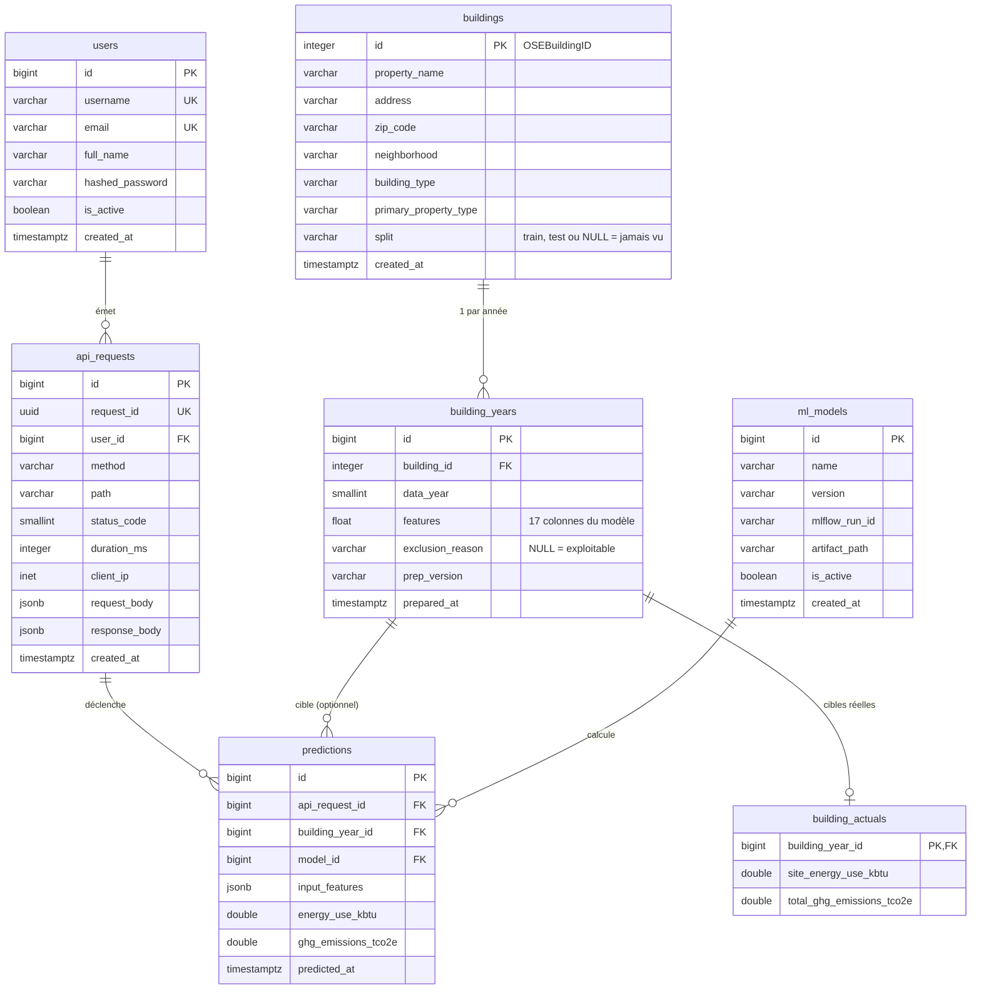

# Base de données PostgreSQL (issue #26)

Ce document décrit la base PostgreSQL du projet : schéma, choix techniques, rôles, mise en route et requêtes d'exemple. La conception complète est dans [`docs/superpowers/specs/2026-10-14-postgresql-integration-design.md`](../superpowers/specs/2026-10-14-postgresql-integration-design.md).

## 1. Schéma



Le diagramme résume les 17 features de `building_years` (identiques à celles du modèle). Le DDL complet est dans [`schema.sql`](schema.sql), généré par `alembic upgrade head --sql` (voir §4). Il ne contient ni les rôles ni les `GRANT` (provisionnés par `app.db.create_db`) et inclut la table `alembic_version`.

## 2. Choix techniques

**D1 — Granularité des traces.** Approche hybride : `api_requests` conserve, en JSONB, le corps de requête et de réponse de tous les appels (par utilisateur) ; la table typée `predictions` (entrée figée en `input_features`, sorties) permet d'interroger efficacement les entrées et sorties du modèle.

**D2 — Rôle du dataset en base.** La base est la source de vérité : `TrainPipeline` lit PostgreSQL (`building_years` des bâtiments portant un `split`) et non plus le CSV.

**D3 — Identité et source rejouable.** `buildings` porte l'identité (nom, adresse, quartier, types) et le split ; il n'y a plus de miroir du CSV. Les CSV de `data/` restent la source rejouable : `app.db.ingest` nettoie, calcule les features et écrit tout en une passe.

**D4 — Modes de prédiction.** Une ligne de `predictions` par modèle appelé, avec l'entrée figée (`input_features`, JSONB). Origine déduite : `api_request_id` et `building_year_id` = `POST /model/predict` et `/model/predict/compare` (deux lignes, même requête) ; `api_request_id` seul = saisie libre (`/model/predict/features`) ; `building_year_id` seul = évaluation projetée (`app.db.evaluate`, hors API). Un échec du modèle ne crée aucune ligne : la tentative reste dans `api_requests`.

**D5 — Périmètre.** Le résidentiel (`Multifamily*`) a une ligne `buildings` mais aucune ligne `building_years` ; une prédiction sur un tel bâtiment renvoie 422.

**D6 — Exclusion.** `exclusion_reason` est renseignée à l'ingestion pour toutes les années. Année d'entraînement (`TRAINING_YEAR`) : outlier, non conforme, cible manquante ou non positive. Autres années : non conforme, `aberrant_energy`, `aberrant_emissions` (`flag_production_exclusion`, `app/training/data_processing.py`). Elle exclut un bâtiment de l'entraînement et de l'évaluation projetée, jamais de la prédiction par identifiant. Le split train/test est une propriété du bâtiment (`buildings.split`, `NULL` = jamais vu).

**D7 — Cibles réelles.** Les cibles vivent dans `building_actuals` ; `building_years` n'en contient aucune, ce qui exclut toute fuite vers l'API. Le rôle `p5_api` n'y a pas accès.

**D8 — JWT.** Le claim `sub` vaut `str(user.id)` ; l'identité est donc stable même si le nom d'utilisateur change.

**D9 — Modèles.** La table `ml_models` référence le run MLflow par `mlflow_run_id`, sans clé étrangère (bases distinctes). L'API sert les fichiers `models/*.cbm` ; `ml_models` trace le run MLflow qui les a produits. Une seule version active par modèle (index unique partiel).

**D10 — MLflow.** Base `mlflow` séparée dans la même instance PostgreSQL ; pas de troisième conteneur. Le rôle `p5_mlflow` en est propriétaire et n'a aucun droit sur `p5`.

**D11 — Stack.** SQLAlchemy 2.0 (déclaratif typé) et Alembic ; `sqlmodel` est retiré. Driver : `psycopg` 3 (URL `postgresql+psycopg://…`).

### Écarts assumés par rapport à la spec

1. `/model/predict/compare` reçoit `{"building_id", "data_year"?}` comme `/model/predict`.
2. `/token` refuse un utilisateur inactif (400), en plus du contrôle `is_active` dans `get_current_user`.
3. `provision()` accepte un préfixe de rôles (`p5` en production, `p5test` en test) pour que les tests n'écrasent pas les mots de passe des rôles de développement sur la même instance.
4. Index `api_requests` en `(user_id, created_at)` et `(path, created_at)` : un btree se parcourt dans les deux sens, `DESC` est inutile.
5. `SELECT` est accordé à `p5_api` sur `api_requests` et `predictions` (en plus des droits de la spec), nécessaire pour `RETURNING` et `UPDATE`.
6. Le compose comporte un service `tools` séparé (profil `tools`) avec des variables d'environnement explicites au lieu d'un `env_file` : les identifiants admin/propriétaire ne sont jamais transmis au service `api`. Le service `api` ne reçoit que `SECRET_KEY` et `DATABASE_URL` (obligatoire, sans valeur par défaut dans le code : erreur explicite au premier usage de la session).
7. Ingestion : une colonne source **obligatoire** absente du fichier (`OSEBuildingID`, `DataYear`, les features du modèle, `NaturalGas(kBtu)`, `SteamUse(kBtu)` et les deux cibles, voir `REQUIRED_SOURCE_COLUMNS` dans `app/db/ingest.py`) fait échouer l'ingestion avec une erreur explicite, au lieu de donner NULL comme le prévoit la spec : un fichier dont l'harmonisation (`app/db/harmonize.py`) serait incomplète serait sinon ingéré sans features ni cibles, en silence. Les autres colonnes absentes donnent bien NULL.
8. Mots de passe des rôles en clair dans le DDL : `create_db` exécute `CREATE ROLE … PASSWORD '…'` / `ALTER ROLE … PASSWORD '…'` avec le mot de passe en littéral (hashé en SCRAM par PostgreSQL au stockage). Si le serveur journalise le DDL (`log_statement = 'ddl'` ou `'all'`), ces mots de passe apparaissent en clair dans les journaux PostgreSQL : désactiver cette journalisation pendant le provisionnement (chaque exécution de `create_db` réapplique les mots de passe lus dans l'environnement).

### Limites connues

- **`artifact_path` partagé.** Toutes les versions de `catboost-multitarget` pointent vers le même dossier `models/`. Si l'enregistrement dans `ml_models` échoue après l'écriture des fichiers, la version active peut ne pas correspondre aux fichiers `.cbm` servis.
- **Version servie et redémarrage.** L'entraînement écrit `models/version.json` (`name`, `version`, `mlflow_run_id`) après l'enregistrement dans `ml_models`. L'API garde les `.cbm` en mémoire et lit ce fichier au premier chargement : chaque prédiction CatBoost référence la ligne `ml_models` de la version **chargée**, pas forcément la version active. Sans `version.json` (fichiers `.cbm` antérieurs), elle se replie sur la version active ; si la version chargée est absente du registre, la prédiction est refusée (503). **Redémarrer l'API après chaque entraînement** (`docker compose restart api`) pour servir la nouvelle version.
- **`/model/predict/compare` et Kumo.** Si l'appel Kumo échoue, la route renvoie 503 mais conserve la prédiction CatBoost déjà enregistrée.
- **Healthcheck.** Le healthcheck du `Dockerfile` appelle `/docs` toutes les 30 secondes ; ce chemin figure dans `UNTRACED_PATHS` du middleware de trace, il n'écrit donc rien en base.

## 3. Rôles et sécurité

| Rôle | Base | Droits |
|---|---|---|
| `p5_owner` | `p5` | Propriétaire du schéma : migrations, `ingest`, entraînement, `evaluate` |
| `p5_api` | `p5` | `SELECT` : `users`, `buildings`, `building_years`, `ml_models` ; `SELECT, INSERT, UPDATE` : `api_requests` ; `SELECT, INSERT` : `predictions` ; `USAGE` sur les séquences d'identité concernées |
| `p5_mlflow` | `mlflow` | Propriétaire de la base `mlflow`, aucun droit sur `p5` |

`building_actuals` reste inaccessible à l'API : les cibles réelles ne peuvent pas fuiter.

Les secrets (`password`, `access_token`, `client_secret`, insensible à la casse) sont remplacés par `"***"` à toute profondeur avant stockage dans `api_requests`. Aucun secret réel n'est commité : `.env` est ignoré par git, `.example.env` ne contient que des valeurs factices.

## 4. Mise en route

Prérequis : Docker, et un fichier `.env` créé à partir de l'exemple (`cp .example.env .env`, puis remplacer les valeurs `change-me*` et `SECRET_KEY`). Les mots de passe des rôles sont lus depuis cet environnement.

**Comptes de démonstration.** `create_db` ne crée `johndoe` (actif) et `alice` (inactive), mot de passe `secret`, que si `P5_SEED_DEMO_USERS=1` (valeur de `.example.env`, transmise au service `tools`) ou avec l'option `--demo-users`. Les modèles initiaux de `ml_models` sont créés dans tous les cas. **En production, laisser `P5_SEED_DEMO_USERS` à 0 ou absent** : un compte au mot de passe public donnerait accès à toute l'API.

**Données sources.** `data/` est ignoré par git et monté **en lecture seule** dans le service `tools` (`./data:/app/data:ro`) : l'option `--download` d'`app.db.ingest` ne peut donc pas écrire le CSV depuis le conteneur. Sur un clone neuf, télécharger le CSV 2016 depuis l'hôte (`uv sync` au préalable) :

```bash
uv run python -c "from app.training.data_processing import ensure_dataset; ensure_dataset(download=True)"
```

```bash
mkdir -p models mlruns
docker compose --profile tools build
docker compose up -d db
docker compose run --rm tools python -m app.db.create_db
docker compose run --rm tools python -m app.db.ingest --year 2016 --csv data/2016_Building_Energy_Benchmarking.csv
# Les modèles models/*.cbm ne sont pas versionnés (git) : les entraîner avant de
# démarrer l'API, sinon toute prédiction répond 503.
docker compose run --rm tools python -m app.training
docker compose up -d api
TOKEN=$(curl -s -X POST localhost:8080/token -d "username=johndoe&password=secret" | python -c "import sys,json;print(json.load(sys.stdin)['access_token'])")
ID=$(docker compose exec -T db psql -U postgres -d p5 -Atc "SELECT building_id FROM building_years LIMIT 1")
curl -s -X POST localhost:8080/model/predict -H "Authorization: Bearer $TOKEN" -H "Content-Type: application/json" -d "{\"building_id\": $ID}"
docker compose exec -T db psql -U postgres -d p5 -c "SELECT path, status_code, user_id FROM api_requests ORDER BY id DESC LIMIT 3"
```

Les fichiers `models/*.cbm` sont ignorés par git : sur un clone neuf, ils n'existent qu'après l'étape `app.training` (environ une minute avec `--no-kumo --cv-splits 2`, plus longtemps avec les réglages par défaut). La réponse contient `prediction_id` et `request_id`. La table `api_requests` contient une ligne par appel, dont `/model/predict` avec le `user_id` renseigné et `/token` avec le mot de passe masqué. Le port hôte de l'API se change avec `API_PORT` (par défaut `8080`).

**Image de base obsolète.** Les dépendances (`psycopg`, `sqlalchemy`, `alembic`…) viennent de l'image de base `:base` publiée sur GHCR. Si elle est antérieure à ces dépendances, `docker compose build` **réussit** quand même (l'image applicative ne fait que copier `app/`) : c'est l'exécution qui échoue (`ModuleNotFoundError: psycopg` au démarrage de `api` ou de `tools`). Pour travailler en local, construire la base : `docker build -f Dockerfile.base -t p5-base .` puis `docker compose --profile tools build --build-arg BASE_IMAGE=p5-base`.

Côté CI, `base-image.yml` se déclenche sur un push dans `main` qui modifie `pyproject.toml`, `uv.lock` ou `Dockerfile.base`, mais `release.yml` part **en parallèle** sur le même push, sans l'attendre : la release peut donc être construite sur l'ancienne `:base`. Le workflow `release.yml` exécute un smoke test (`python -c "import psycopg, sqlalchemy, alembic, app.main"`) qui fait échouer la release plutôt que de publier une image cassée. Deux façons de s'en prémunir :

- **après le merge** (recommandé) : si le smoke test échoue sur `ModuleNotFoundError`, attendre la fin du run `base-image`, puis relancer la release (`gh run rerun <id>`) ;
- **avant le merge** : lancer `base-image.yml` manuellement (`workflow_dispatch`) en choisissant la branche de la PR (`gh workflow run base-image.yml --ref <branche>`). Attention : le workflow pousse **toujours** le tag `:base`, il n'existe pas de tag par branche. Cette base remplace donc celle de `main` pour tous les builds jusqu'au prochain run sur `main` ; ne le faire que si la PR va être mergée.

### Entraînement, évaluation et DDL

```bash
# Entraînement depuis PostgreSQL (écrit models/*.cbm, models/scores.json et
# models/version.json, trace ml_models), puis redémarrage de l'API pour servir la
# nouvelle version
docker compose run --rm tools python -m app.training
docker compose restart api

# Évaluation projetée sur les années de production
docker compose run --rm tools python -m app.db.evaluate --years 2017 2018 2019

# Régénération du DDL livrable (hors conteneur)
DATABASE_OWNER_URL=postgresql+psycopg://x@localhost/p5 uv run alembic upgrade head --sql > docs/db/schema.sql
```

**Service `tools` et fichiers de l'hôte.** Le service `tools` tourne avec l'uid/gid de l'hôte (`user: "${UID:-1000}:${GID:-1000}"`) pour pouvoir écrire dans les montages `./models` et `./mlruns`. Si `id -u` / `id -g` ne valent pas 1000, ajouter `UID=…` et `GID=…` au fichier `.env` (en bash, `UID` est une variable en lecture seule non exportée : la définir dans `.env` est le plus simple). Créer les dossiers avant le premier lancement (`mkdir -p models mlruns`), sinon Docker les crée au nom de root. Les journaux CatBoost (`catboost_info/`) vont dans un `tmpfs` jetable.

**Artefacts MLflow.** Les métadonnées MLflow sont dans la base `mlflow`, les artefacts dans `./mlruns` (monté sur `/app/mlruns`). Chaque expérience mémorise un `artifact_location` **absolu** fixé à sa création : une expérience créée depuis l'hôte (`uv run python -m app.training`) pointe vers `/chemin/de/l/hôte/mlruns/<id>`, introuvable dans le conteneur (l'entraînement échoue alors sur `PermissionError` à l'enregistrement des artefacts), et inversement une expérience créée par `tools` pointe vers `/app/mlruns/<id>`. Dans ce cas, soit entraîner en local avec `uv run python -m app.training`, soit utiliser une expérience dédiée au conteneur :

```bash
docker compose run --rm -e MLFLOW_EXPERIMENT=seattle-energy-docker tools python -m app.training
```

### Années de production 2017–2019

Les années 2017, 2018 et 2019 proviennent de l'open data de Seattle ([Building Energy Benchmarking Data, 2015-Present](https://data.seattle.gov/Built-Environment/Building-Energy-Benchmarking-Data-2015-Present/teqw-tu6e/about_data)). `data/` n'est pas versionné et il est monté en lecture seule dans `tools` : télécharger les CSV depuis l'hôte (`download_open_data_year` récupère l'export complet et n'en garde que l'année demandée ; un fichier déjà présent n'est pas retéléchargé), puis ingérer dans le conteneur sans `--download`.

```bash
uv run python -c "from app.db.harmonize import download_open_data_year as d; [d(y, f'data/{y}_Building_Energy_Benchmarking.csv') for y in (2017, 2018, 2019)]"
for y in 2017 2018 2019; do
  docker compose run --rm tools python -m app.db.ingest --year $y \
    --csv data/${y}_Building_Energy_Benchmarking.csv
done
docker compose run --rm tools python -m app.db.evaluate --years 2017 2018 2019
```

**Harmonisation vers le schéma 2016** (`app/db/harmonize.py`, appliquée à l'ingestion dès que la colonne `EPAPropertyType` est présente). Le jeu open data n'a pas le schéma du CSV 2016 sur lequel le modèle est entraîné ; les correspondances ont été établies en croisant les lignes 2016 des deux sources (3 194 bâtiments communs) :

| Écart | Traitement | Concordance mesurée sur 2016 (périmètre non résidentiel) |
|---|---|---|
| `BuildingName`, `PropertyGFABuildings` | renommées en `PropertyName`, `PropertyGFABuilding(s)` | — |
| `PrimaryPropertyType` absente | reconstituée depuis `EPAPropertyType` (`EPA_TO_PRIMARY`, sinon `Other`) ; `Office` scindé en `Large Office` / `Small- and Mid-Sized Office` au seuil de 100 000 sf de `PropertyGFATotal` | 98,6 % |
| `BuildingType` regroupé (`School`, `Hospital`, `University` ; plus de `Nonresidential COS` ni `Campus`) | valeur 2016 du bâtiment reprise s'il était déjà présent (et que son caractère résidentiel n'a pas changé), sinon `BUILDING_TYPE_FALLBACK` | 100 % (91,8 % sans la référence 2016) |
| Libellés d'usage renommés (`Senior Living Community`, `Vehicle Dealership`, `Vehicle Repair Services`) | ramenés aux libellés 2016 (`USE_TYPE_LABELS`) | `LargestPropertyUseType` 99,1 % |

Les colonnes propres à l'open data (`ComplianceIssue`, `Demolished`, `SelfReport*`) sont ignorées. Restent des différences de **contenu** que l'harmonisation ne corrige pas : Seattle a révisé ses données (usages secondaires renseignés là où le CSV 2016 était vide, émissions recalculées à ±1 %), et quelques libellés nouveaux (`Electric Vehicle Charging Station`, `Transportation Terminal/Station`…) sont inconnus du modèle, que CatBoost traite comme une modalité non vue. La préparation des features est ensuite strictement celle de l'entraînement, faite à l'ingestion.

**Filtrage de l'évaluation projetée** (`building_years.exclusion_reason`, calculée à l'ingestion). Comme pour l'entraînement, les bâtiments non conformes (`ComplianceStatus` ≠ `Compliant`) sont exclus. Le flag `Outlier` de 2016 n'existe plus dans l'open data ; il est remplacé par des plages d'intensité plausibles, arrondies depuis les bâtiments éligibles de 2016 : EUI réelle (`SiteEnergyUse` / `PropertyGFATotal`) entre 1 et 1 000 kBtu/sf, émissions ≤ 0,05 t CO2e/sf. Certaines déclarations sont en effet erronées tout en étant marquées `Compliant` (bâtiment 755 en 2019 : 5,9 × 10⁹ kBtu, 278 fois sa consommation 2018) et suffisaient à écraser le R² d'une année. Le nombre de bâtiments exclus est affiché (`n_excluded`).

| Année | Exclus | R² énergie | MedAPE énergie | R² émissions | MedAPE émissions |
|---|---|---|---|---|---|
| 2017 | 137 | 0,51 | 32,5 % | 0,44 | 43,6 % |
| 2018 | 170 | 0,42 | 32,8 % | 0,51 | 46,1 % |
| 2019 | 124 | 0,31 | 33,5 % | 0,31 | 45,0 % |

(modèle `catboost-multitarget v20261015090207` ; jeu de test 2016 : MedAPE 36,2 % / 46,4 %.)

L'ingestion est idempotente (upsert sur `(building_id, data_year)`) ; les doublons d'`OSEBuildingID` sont dédupliqués (dernier gardé) avec un avertissement.

## 5. Exemples de requêtes SQL

```sql
-- Dernières requêtes d'un utilisateur
SELECT created_at, method, path, status_code, duration_ms
FROM api_requests WHERE user_id = 1 ORDER BY created_at DESC LIMIT 20;

-- Prédictions d'un bâtiment, toutes versions confondues
SELECT y.data_year, m.name, m.version, p.energy_use_kbtu, p.predicted_at
FROM predictions p
JOIN building_years y ON y.id = p.building_year_id
JOIN ml_models m ON m.id = p.model_id
WHERE y.building_id = 1 ORDER BY p.predicted_at DESC;

-- Erreur médiane relative par année (évaluation projetée). La vue expose
-- exclusion_reason : la condition reproduit le filtre de app.db.evaluate.
SELECT e.data_year, e.model_version, count(*) AS n,
       percentile_cont(0.5) WITHIN GROUP (ORDER BY e.rel_err_energy) AS medape_energy
FROM v_projected_evaluation e
WHERE e.exclusion_reason IS NULL AND e.actual_energy_kbtu > 0
GROUP BY e.data_year, e.model_version ORDER BY e.data_year;

-- Répartition du jeu d'entraînement
SELECT b.split, y.exclusion_reason, count(*)
FROM building_years y JOIN buildings b ON b.id = y.building_id
WHERE y.data_year = 2016 GROUP BY b.split, y.exclusion_reason;
```
