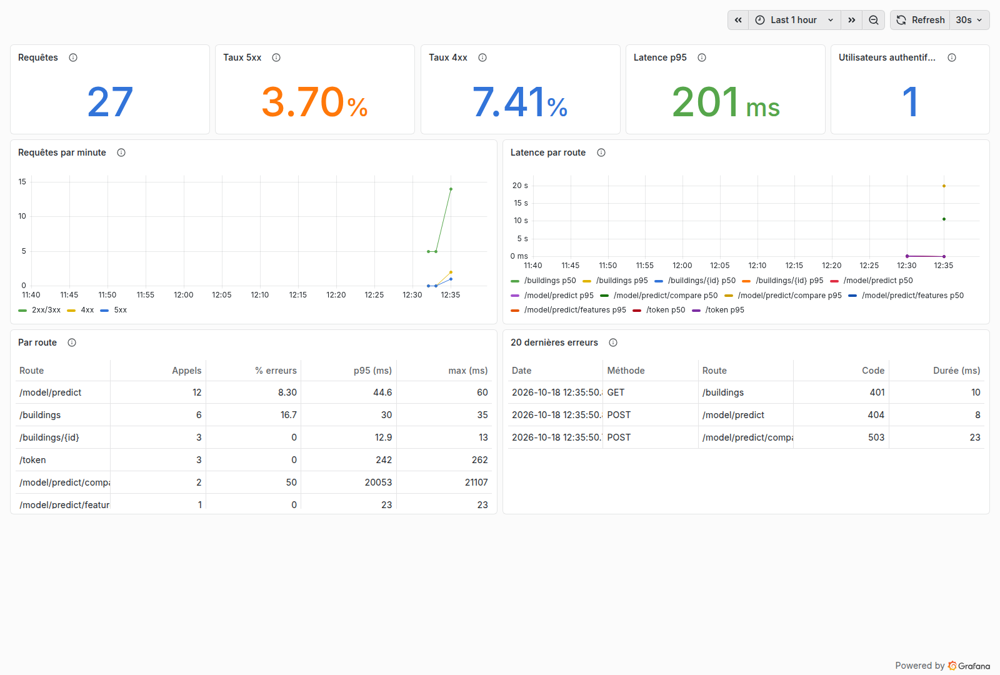
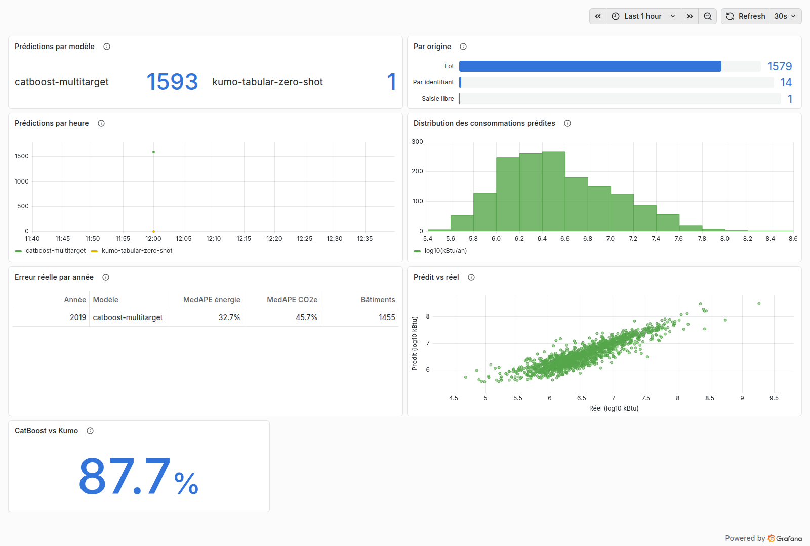

# 📈 Monitoring (Grafana)

Deux tableaux de bord Grafana lisent la base PostgreSQL : **« P5 — API »** (santé du service) et **« P5 — Modèle »** (suivi du modèle). Ils sont démarrés et vérifiés par le Quickstart. La conception est décrite dans [`docs/superpowers/specs/2026-10-18-grafana-monitoring-design.md`](../superpowers/specs/2026-10-18-grafana-monitoring-design.md).

## Accès

| | |
|---|---|
| URL | http://localhost:3000 (`GRAFANA_PORT` pour changer de port ; écoute sur `127.0.0.1` uniquement) |
| Compte | `admin`, mot de passe `GRAFANA_ADMIN_PASSWORD` dans `.env` (aléatoire, généré par le Quickstart) |
| Accès anonyme | désactivé, comme l'inscription |

Après connexion, la page d'accueil est le tableau « API » ; « Modèle » est dans le dossier **P5** (menu *Dashboards*). Plage par défaut : dernières 24 h, rafraîchissement toutes les 30 s.

Le service est **sans état** : la datasource et les tableaux de bord viennent de [`grafana/provisioning/`](../../grafana/provisioning/) (monté en lecture seule) et ne sont pas modifiables dans l'interface. Recréer le conteneur ne perd rien.

## Tableau « API »



| Panneau | Ce qu'il montre |
|---|---|
| Requêtes | Nombre d'appels sur la période, toutes routes confondues |
| Taux 5xx | Part des requêtes terminées en erreur serveur (modèle ou base indisponible) ; orange dès 1 %, rouge dès 5 % |
| Taux 4xx | Part des requêtes refusées : jeton absent (401), bâtiment vu à l'entraînement (403), inconnu (404), saisie invalide (422) |
| Latence p95 | 95 % des requêtes répondent en moins de ce temps ; orange dès 1 s, rouge dès 5 s |
| Utilisateurs authentifiés | Utilisateurs distincts ayant appelé l'API avec un jeton valide |
| Requêtes par minute | Volume par classe de statut (2xx/3xx, 4xx, 5xx) |
| Latence par route | Médiane et p95 par route, par fenêtre de 5 min. Le premier `/model/predict/compare` après un démarrage inclut le téléchargement des poids Kumo (~15 s) |
| Par route | Appels, part d'erreurs, p95 et maximum par route ; les identifiants sont regroupés (`/buildings/{id}`) |
| 20 dernières erreurs | Date, méthode, route, code et durée des derniers appels en erreur |

Les taux ne comptent que les requêtes terminées : une requête en cours (ou interrompue avant sa finalisation) n'a pas encore de statut et n'est pas comptée comme une erreur.

## Tableau « Modèle »



| Panneau | Ce qu'il montre |
|---|---|
| Prédictions par modèle | Prédictions enregistrées sur la période : CatBoost (servi) et Kumo-Tabular (comparaison) |
| Par origine | **Par identifiant** (`/model/predict`, `/compare`), **saisie libre** (`/model/predict/features`), **lot** (évaluation projetée) |
| Prédictions par heure | Volume de prédictions par modèle |
| Distribution des consommations prédites | Histogramme en log10 (kBtu/an) : un déplacement de la distribution signale une dérive des entrées ou du modèle |
| Erreur réelle par année | Erreur relative médiane (MedAPE) énergie et CO2e face aux consommations réelles déclarées, par année et modèle |
| Prédit vs réel | Un point par bâtiment évalué (log10), idéalement sur la diagonale |
| CatBoost vs Kumo | Sur les appels `/compare` : écart relatif médian de la consommation prédite par Kumo par rapport à CatBoost |

« Erreur réelle par année » et « Prédit vs réel » lisent la vue `v_projected_evaluation` et ne dépendent pas de la plage de temps. Ils sont alimentés par l'évaluation projetée, que le Quickstart lance pour 2019 ; pour d'autres années :

```bash
docker compose run --rm tools python -m app.db.ingest --year 2018 --csv data/2018_Building_Energy_Benchmarking.csv --download
docker compose run --rm tools python -m app.db.evaluate --years 2018
```

## Droits du rôle `p5_grafana`

Grafana se connecte avec un rôle dédié, en lecture seule, créé par `app.db.create_db` (mot de passe `P5_GRAFANA_PASSWORD`) :

| Objet | Accès |
|---|---|
| `api_requests` | `id, user_id, method, path, status_code, duration_ms, created_at` uniquement |
| `predictions` | `id, api_request_id, building_year_id, model_id, energy_use_kbtu, ghg_emissions_tco2e, predicted_at` uniquement |
| `ml_models`, `v_projected_evaluation` | lecture |
| Tout le reste | refusé : corps de requête et de réponse, IP, `input_features`, `users` (e-mails), `buildings`, `building_years`, `building_actuals`, toute écriture |

La vue s'exécute avec les droits de son propriétaire : Grafana obtient les erreurs agrégées sans accès direct aux cibles réelles. Les droits sont vérifiés par `tests/test_grafana_role.py`.

Sur une installation antérieure, relancer le Quickstart (ou `docker compose run --rm tools python -m app.db.create_db`) crée le rôle ; le Quickstart ajoute aussi à `.env` les deux mots de passe manquants sans toucher aux autres.

## Ajouter ou modifier un panneau

1. Éditer `grafana/provisioning/dashboards/api.json` ou `model.json` : requête SQL brute (`rawQuery: true`), datasource `p5-postgres`, `pluginVersion` égal à la version de l'image (`12.4.3`) pour éviter la migration automatique des panneaux au chargement.
2. Macros autorisées : `$__timeFilter(colonne)` et `$__timeGroupAlias(colonne, 1m|5m|1h|1d)` ; aucune variable de template.
3. Vérifier : `uv run pytest tests/test_grafana_dashboards.py` exécute chaque requête **sous le rôle Grafana**, sur une base vide et sur une base peuplée (une colonne non autorisée fait échouer le test).
4. Recharger : `docker compose restart grafana`.
