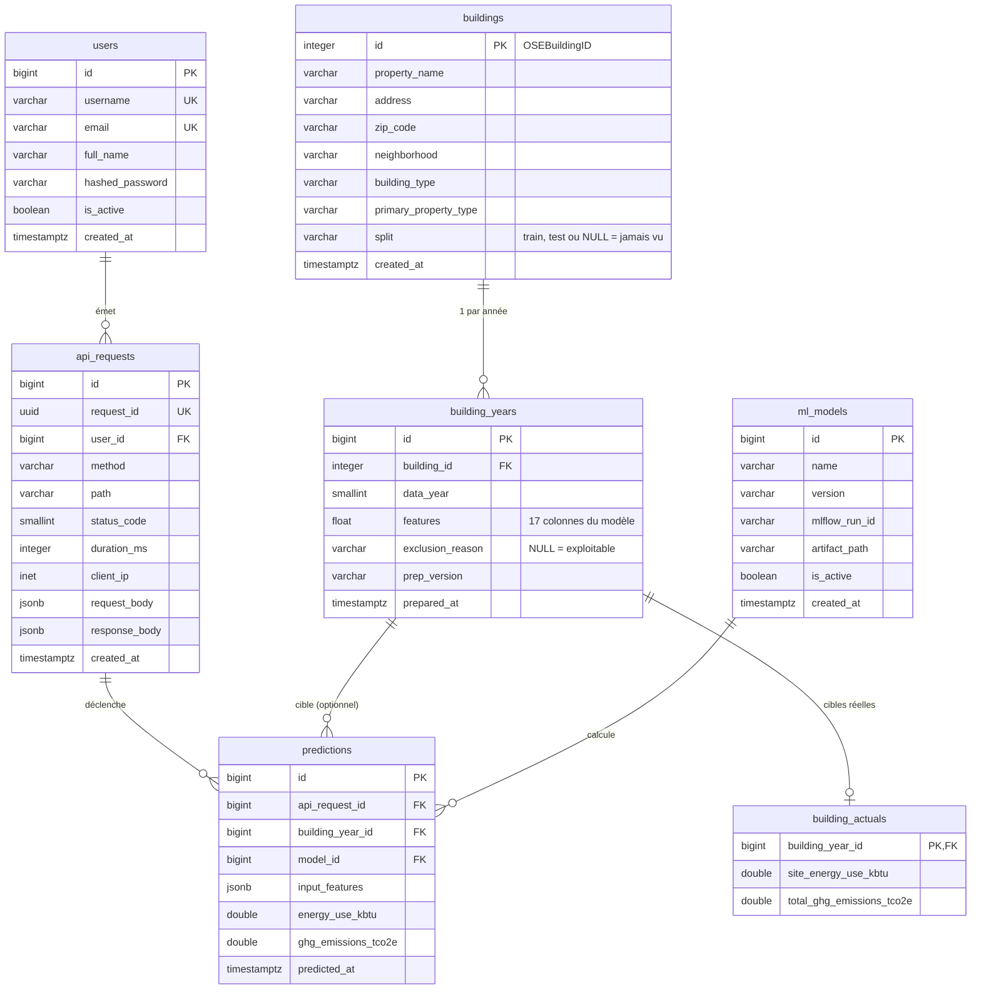

# Refonte du schéma (PR 1) Implementation Plan

> **For agentic workers:** REQUIRED SUB-SKILL: Use superpowers:subagent-driven-development (recommended) or superpowers:executing-plans to implement this plan task-by-task. Steps use checkbox (`- [ ]`) syntax for tracking.

**Goal :** Passer de 9 à 7 tables (spec `docs/superpowers/specs/2026-10-15-schema-simplifie-routes-batiments-design.md`, §3 à §8, chantier 1) sans changer le comportement de l'API, en portant le split train/test par bâtiment.

**Architecture :** `buildings` (identité + `split`) 1—n `building_years` (17 features + `exclusion_reason`) 1—0..1 `building_actuals` ; `predictions` porte l'entrée figée (`input_features` JSONB). L'ingestion fait tout en une passe (plus de table brute, plus de commande `prepare`). Migration Alembic destructive, données reconstruites depuis `data/*.csv`.

**Tech Stack :** Python 3.14, SQLAlchemy 2.0, Alembic, PostgreSQL 17, FastAPI, pytest, ruff, uv.

**Le chantier 2 (routes `/buildings`, 403 sur `/model/predict`) fait l'objet d'un plan séparé, après le merge de cette PR.**

---

## Conséquences de la spec à connaître (décisions de ce plan)

1. **Échec d'un modèle = aucune ligne `predictions`.** Une prédiction porte son entrée ; il n'y a plus de ligne « entrée seule ». La tentative reste tracée dans `api_requests` (corps de requête, statut 503).
2. **Les bâtiments hors périmètre (résidentiels) gardent une ligne `buildings`** (identité seule, pas de `building_years`) pour que `/model/predict` réponde toujours 422 « hors périmètre » et non 404.
3. **`ingest_frame` perd le paramètre `source_file`** (la colonne disparaît avec le brut).
4. **`reference_building_types` lit `buildings.building_type`** (dernier type ingéré) au lieu du brut de l'année d'entraînement.
5. **`evaluate` ignore l'année d'entraînement** (`TRAINING_YEAR`) : l'ancien filtre `dataset_role = 'production'` devient `data_year != TRAINING_YEAR`.
6. **`exclusion_reason` accepte deux libellés de plus** : `aberrant_energy`, `aberrant_emissions` (règles d'évaluation, désormais calculées à l'ingestion).
7. **Les commits intermédiaires ne sont pas tous verts sur la suite complète** (le schéma change d'un bloc) ; chaque tâche indique le sous-ensemble de tests à faire passer, la suite complète doit être verte à la tâche 8.

## Structure des fichiers

| Fichier | Rôle après refonte |
|---|---|
| `app/db/models.py` | `Building`, `BuildingYear`, `BuildingActual`, `Prediction` (+ tables inchangées) |
| `app/db/mapping.py` | `SOURCE_COLUMNS` (ex-`RAW_SQL`), `FEATURE_SQL`, `TARGET_SQL`, conversions |
| `app/training/data_processing.py` | + `flag_production_exclusion`, `SITE_EUI_RANGE`, `GHG_INTENSITY_MAX` |
| `app/db/prepare.py` | Fonctions pures : `build_feature_rows` ; plus de CLI ni d'accès base |
| `app/db/ingest.py` | Ingestion en une passe + split par bâtiment |
| `app/db/training_data.py` | Lecture du jeu d'entraînement par `buildings.split` |
| `app/core/prediction_service.py` | `ModelInput`, `resolve_features`, `run_model` écrivant `predictions` |
| `app/routers/model.py` | Adapté à `ModelInput` |
| `app/db/evaluate.py` | Évaluation sur `building_years`/`predictions`, exclusion lue en base |
| `app/db/views.py` | `v_projected_evaluation` réécrite |
| `app/db/create_db.py` | `API_GRANTS` sans droit par colonne |
| `app/db/migrations/versions/3b8e1f6a42c7_schema_simplifie.py` | Migration destructive |
| `tests/synth.py` | `add_building`, `add_year` remplacent `add_record` |

---

### Task 0 : Issue et branche

- [ ] **Step 1 : Créer l'issue**

```bash
gh issue create --title "Refonte du schéma : 7 tables, split par bâtiment, ingestion en une passe" --body "Chantier 1 de la spec docs/superpowers/specs/2026-10-15-schema-simplifie-routes-batiments-design.md (issue #45 pour le chantier 2). Supprime building_records_raw, building_features, prediction_inputs ; ajoute building_years ; le split devient une propriété du bâtiment ; la commande prepare disparaît."
```

Noter le numéro `N` affiché.

- [ ] **Step 2 : Créer la branche depuis l'état courant** (elle embarque la spec et le `.gitignore` déjà commités)

```bash
git checkout -b refactor/schema-simplifie-N
```

---

### Task 1 : Modèles ORM et mapping

**Files :**
- Modify: `app/db/models.py`
- Modify: `app/db/mapping.py`
- Test: `tests/test_db_models.py` (réécriture complète)

- [ ] **Step 1 : Écrire les tests** — remplacer tout `tests/test_db_models.py` par :

```python
"""Tests unitaires du schéma ORM et des correspondances (sans base)."""

import math
import sys
from pathlib import Path

import numpy as np

sys.path.insert(0, str(Path(__file__).resolve().parents[1]))

from app.db import mapping
from app.db.models import Base, Building, BuildingActual, BuildingYear
from app.schemas.api import FEATURE_COLUMNS


def test_all_tables_declared():
    assert set(Base.metadata.tables) == {
        "users",
        "api_requests",
        "buildings",
        "building_years",
        "building_actuals",
        "ml_models",
        "predictions",
    }


def test_feature_sql_covers_feature_columns_in_order():
    assert list(mapping.FEATURE_SQL) == FEATURE_COLUMNS


def test_feature_block_in_building_years():
    for col in mapping.FEATURE_SQL.values():
        assert col in BuildingYear.__table__.columns


def test_source_columns_are_unique_csv_names():
    assert len(mapping.SOURCE_COLUMNS) == 46
    assert len(set(mapping.SOURCE_COLUMNS)) == 46
    assert mapping.SOURCE_COLUMNS[0] == "OSEBuildingID"


def test_target_sql_targets_actuals():
    for col in mapping.TARGET_SQL.values():
        assert col in BuildingActual.__table__.columns


def test_to_python_handles_numpy_and_nan():
    assert mapping.to_python(np.int64(3)) == 3
    assert type(mapping.to_python(np.int64(3))) is int
    assert mapping.to_python(float("nan")) is None
    assert mapping.to_python(np.float64("nan")) is None
    assert mapping.to_python(None) is None


def test_coerce_row_by_column_type():
    years = mapping.coerce_row(
        BuildingYear,
        {
            "year_built": np.float64(1990.0),
            "has_steam": "False",
            "latitude": np.float64(47.6),
            "number_of_buildings": float("nan"),
        },
    )
    assert years == {
        "year_built": 1990,
        "has_steam": False,
        "latitude": 47.6,
        "number_of_buildings": None,
    }
    identity = mapping.coerce_row(Building, {"zip_code": 98101.0, "address": float("nan")})
    assert identity == {"zip_code": "98101", "address": None}


def test_features_roundtrip():
    features = {
        "BuildingType": "NonResidential",
        "PrimaryPropertyType": "Office",
        "Neighborhood": "DOWNTOWN",
        "Latitude": 47.6,
        "Longitude": -122.3,
        "YearBuilt": 1990,
        "NumberofBuildings": 1.0,
        "NumberofFloors": 4,
        "PropertyGFAParking": 0,
        "PropertyGFABuilding(s)": 15000,
        "LargestPropertyUseType": "Office",
        "SecondLargestPropertyUseType": "UNKNOWN",
        "SecondLargestPropertyUseTypeGFA": float("nan"),
        "ThirdLargestPropertyUseType": "UNKNOWN",
        "ThirdLargestPropertyUseTypeGFA": float("nan"),
        "Has_NaturalGas": 1,
        "Has_Steam": 0,
    }
    sql = mapping.features_to_sql(features)
    assert sql["has_natural_gas"] is True
    assert sql["has_steam"] is False
    assert sql["second_largest_property_use_type_gfa"] is None
    obj = BuildingYear(**sql)
    back = mapping.features_from_sql(obj)
    assert list(back) == FEATURE_COLUMNS
    assert back["Has_NaturalGas"] == 1
    assert back["Has_Steam"] == 0
    assert back["SecondLargestPropertyUseTypeGFA"] is None
    assert mapping.feature_values(obj)["latitude"] == 47.6
    assert not math.isnan(back["Latitude"])
```

- [ ] **Step 2 : Vérifier l'échec**

Run: `uv run pytest tests/test_db_models.py -q`
Expected: FAIL (`ImportError: cannot import name 'BuildingYear'`).

- [ ] **Step 3 : Modifier `app/db/models.py`**

3a. Docstring de `FeatureColumns` : remplacer `"""Bloc des 17 features (spec §3.2), partagé par features et inputs."""` par `"""Bloc des 17 features du modèle."""`.

3b. Supprimer les classes `Building`, `BuildingRecordRaw`, `BuildingFeatures`, `BuildingActual` (section `# --- Dataset ---`) et les remplacer par :

```python
class Building(Base):
    """Identité d'un bâtiment ; `split` le range côté entraînement ou « jamais vu »."""

    __tablename__ = "buildings"
    __table_args__ = (
        CheckConstraint("split IN ('train', 'test')", name="split_values"),
    )

    id: Mapped[int] = mapped_column(Integer, primary_key=True, autoincrement=False)
    property_name: Mapped[str | None] = mapped_column(String(255))
    address: Mapped[str | None] = mapped_column(String(255))
    zip_code: Mapped[str | None] = mapped_column(String(10))
    neighborhood: Mapped[str | None] = mapped_column(String(64))
    building_type: Mapped[str | None] = mapped_column(String(64))
    primary_property_type: Mapped[str | None] = mapped_column(String(64))
    # NULL = jamais vu par l'entraînement (ni train ni test).
    split: Mapped[str | None] = mapped_column(String(8))
    created_at: Mapped[datetime] = _created_at()


class BuildingYear(FeatureColumns, Base):
    """Features d'un bâtiment pour une année : uniquement le périmètre du modèle."""

    __tablename__ = "building_years"
    __table_args__ = (
        UniqueConstraint("building_id", "data_year"),
        CheckConstraint("data_year BETWEEN 2015 AND 2100", name="data_year_range"),
        CheckConstraint(
            "exclusion_reason IN ('outlier', 'non_compliant', "
            "'non_positive_target', 'missing_target', "
            "'aberrant_energy', 'aberrant_emissions')",
            name="exclusion_reason_values",
        ),
        Index("ix_building_years_data_year", "data_year"),
    )

    id: Mapped[int] = _pk()
    building_id: Mapped[int] = mapped_column(ForeignKey("buildings.id"))
    data_year: Mapped[int] = mapped_column(SmallInteger)
    exclusion_reason: Mapped[str | None] = mapped_column(String(32))
    prep_version: Mapped[str] = mapped_column(String(32))
    prepared_at: Mapped[datetime] = _created_at()


class BuildingActual(Base):
    """Cibles réelles, isolées des features (jamais lues par l'API)."""

    __tablename__ = "building_actuals"

    building_year_id: Mapped[int] = mapped_column(
        ForeignKey("building_years.id", ondelete="CASCADE"), primary_key=True
    )
    site_energy_use_kbtu: Mapped[float | None] = mapped_column(Double)
    total_ghg_emissions_tco2e: Mapped[float | None] = mapped_column(Double)
```

3c. Supprimer les classes `PredictionInput` et `Prediction`, les remplacer par :

```python
class Prediction(Base):
    """Une prédiction d'un modèle, avec l'entrée figée qui l'a produite.

    Origine déduite des colonnes : requête + année = appel API par bâtiment ;
    requête seule = saisie libre ; année seule = évaluation par lot.
    """

    __tablename__ = "predictions"
    __table_args__ = (
        CheckConstraint(
            "api_request_id IS NOT NULL OR building_year_id IS NOT NULL",
            name="has_origin",
        ),
        Index("ix_predictions_model_predicted", "model_id", "predicted_at"),
        Index("ix_predictions_api_request_id", "api_request_id"),
        Index("ix_predictions_building_year_id", "building_year_id"),
        # Une seule prédiction par lot (hors API) pour une ligne d'année et un modèle.
        Index(
            "uq_predictions_batch",
            "building_year_id",
            "model_id",
            unique=True,
            postgresql_where=text("api_request_id IS NULL"),
        ),
    )

    id: Mapped[int] = _pk()
    api_request_id: Mapped[int | None] = mapped_column(ForeignKey("api_requests.id"))
    building_year_id: Mapped[int | None] = mapped_column(
        ForeignKey("building_years.id")
    )
    model_id: Mapped[int] = mapped_column(ForeignKey("ml_models.id"))
    input_features: Mapped[dict[str, Any]] = mapped_column(JSONB)
    energy_use_kbtu: Mapped[float] = mapped_column(Double)
    ghg_emissions_tco2e: Mapped[float] = mapped_column(Double)
    predicted_at: Mapped[datetime] = _created_at()
```

3d. Retirer l'import devenu inutile `Text` ; `uv run ruff check app/db/models.py --fix` pour confirmer.

- [ ] **Step 4 : Modifier `app/db/mapping.py`**

4a. Import : `from app.db.models import BuildingFeatures` → `from app.db.models import BuildingYear`.

4b. Remplacer le bloc `# Colonnes du CSV 2016 → colonnes de building_records_raw.` + `RAW_SQL: dict[str, str] = { … }` par :

```python
# Colonnes du CSV 2016 conservées à l'ingestion (les autres sont ignorées).
SOURCE_COLUMNS: tuple[str, ...] = (
    "OSEBuildingID",
    "DataYear",
    "BuildingType",
    "PrimaryPropertyType",
    "PropertyName",
    "Address",
    "City",
    "State",
    "ZipCode",
    "TaxParcelIdentificationNumber",
    "CouncilDistrictCode",
    "Neighborhood",
    "Latitude",
    "Longitude",
    "YearBuilt",
    "NumberofBuildings",
    "NumberofFloors",
    "PropertyGFATotal",
    "PropertyGFAParking",
    "PropertyGFABuilding(s)",
    "ListOfAllPropertyUseTypes",
    "LargestPropertyUseType",
    "LargestPropertyUseTypeGFA",
    "SecondLargestPropertyUseType",
    "SecondLargestPropertyUseTypeGFA",
    "ThirdLargestPropertyUseType",
    "ThirdLargestPropertyUseTypeGFA",
    "YearsENERGYSTARCertified",
    "ENERGYSTARScore",
    "SiteEUI(kBtu/sf)",
    "SiteEUIWN(kBtu/sf)",
    "SourceEUI(kBtu/sf)",
    "SourceEUIWN(kBtu/sf)",
    "SiteEnergyUse(kBtu)",
    "SiteEnergyUseWN(kBtu)",
    "SteamUse(kBtu)",
    "Electricity(kWh)",
    "Electricity(kBtu)",
    "NaturalGas(therms)",
    "NaturalGas(kBtu)",
    "DefaultData",
    "Comments",
    "ComplianceStatus",
    "Outlier",
    "TotalGHGEmissions",
    "GHGEmissionsIntensity",
)
```

4c. Dans `features_to_sql`, remplacer `BuildingFeatures` par `BuildingYear` :

```python
    return coerce_row(
        BuildingYear, {col: features[name] for name, col in FEATURE_SQL.items()}
    )
```

- [ ] **Step 5 : Vérifier**

Run: `uv run pytest tests/test_db_models.py -q`
Expected: PASS (8 tests).

- [ ] **Step 6 : Commit**

```bash
git add app/db/models.py app/db/mapping.py tests/test_db_models.py
git commit -m "refactor(db): modèles buildings, building_years, predictions (#N)"
```

---

### Task 2 : Fonctions pures de préparation

**Files :**
- Modify: `app/training/data_processing.py` (insérer avant `def assign_split(`)
- Modify (réécriture complète): `app/db/prepare.py`
- Create: `tests/test_prepare.py`
- Delete: `tests/test_db_prepare.py`

- [ ] **Step 1 : Écrire les tests** — créer `tests/test_prepare.py` :

```python
"""Préparation d'un fichier annuel : features, exclusion et split (sans base)."""

import logging

import numpy as np
import pandas as pd
from synth import make_synth

from app.db import prepare
from app.training import data_processing as dp
from app.training.pipeline import TrainPipeline


def test_feature_rows_split_matches_legacy_pipeline():
    df = make_synth(200)
    rows = prepare.build_feature_rows(df, training=True)
    legacy = TrainPipeline(df_raw=df, seed=42, test_size=0.2).split()
    assert set(rows.index[rows["split"] == "train"]) == set(legacy.idx_train)
    assert set(rows.index[rows["split"] == "test"]) == set(legacy.idx_test)


def test_feature_rows_exclude_residential_keep_outliers():
    df = make_synth(80)
    rows = prepare.build_feature_rows(df, training=True)
    residential = df.index[df["BuildingType"].str.startswith("Multifamily")]
    assert not set(residential) & set(rows.index)
    assert rows.loc[2, "exclusion_reason"] == "outlier"
    assert pd.isna(rows.loc[2, "split"])


def test_feature_rows_production_rows_have_no_split():
    rows = prepare.build_feature_rows(make_synth(40), training=False)
    assert rows["split"].isna().all()
    assert rows.loc[4, "exclusion_reason"] == "non_compliant"
    assert set(rows["exclusion_reason"].dropna()) <= {
        "non_compliant",
        "aberrant_energy",
        "aberrant_emissions",
    }


def test_feature_rows_skip_missing_required_feature(caplog):
    df = make_synth(40)
    df.loc[0, "Latitude"] = np.nan
    with caplog.at_level(logging.WARNING):
        rows = prepare.build_feature_rows(df, training=False)
    assert 0 not in rows.index
    assert "feature obligatoire manquante" in caplog.text


def test_flag_production_exclusion_flags_non_compliant_and_aberrations():
    df = pd.DataFrame(
        {
            "ComplianceStatus": ["Compliant", "Not Compliant"] + ["Compliant"] * 4,
            "PropertyGFATotal": [10_000, 10_000, 10_000, 10_000, 10_000, 0],
            "SiteEnergyUse(kBtu)": [5e5, 5e5, 5e9, 5e3, 5e5, 5e5],
            "TotalGHGEmissions": [20.0, 20.0, 20.0, 20.0, 4_000.0, 20.0],
        }
    )
    assert dp.flag_production_exclusion(df).tolist() == [
        None,
        "non_compliant",
        "aberrant_energy",  # 500 000 kBtu/sf
        "aberrant_energy",  # 0,5 kBtu/sf
        "aberrant_emissions",  # 400 kg/sf
        None,  # surface inconnue : pas d'intensité calculable
    ]
```

- [ ] **Step 2 : Vérifier l'échec**

Run: `uv run pytest tests/test_prepare.py -q`
Expected: FAIL (`ImportError` ou `AttributeError: flag_production_exclusion`).

- [ ] **Step 3 : Ajouter dans `app/training/data_processing.py`**, juste avant `def assign_split(` :

```python
# Plages plausibles d'intensité (cible réelle / PropertyGFATotal), arrondies à
# partir des bâtiments éligibles de 2016 (EUI 1,4–906 kBtu/sf ; émissions
# ≤ 34 kg CO2e/sf). L'open data n'a plus la colonne Outlier de 2016 : sans ce
# garde-fou, une seule déclaration erronée suffit à écraser le R² d'une année.
SITE_EUI_RANGE = (1.0, 1000.0)  # kBtu/sf
GHG_INTENSITY_MAX = 0.05  # t CO2e/sf


def flag_production_exclusion(df: pd.DataFrame) -> pd.Series:
    """Raison d'exclure un bâtiment de l'évaluation des années de production.

    Conformité, puis intensités d'énergie et d'émissions hors plages (None =
    conservé). Ne sert qu'à l'évaluation : la prédiction par identifiant l'ignore.
    """
    reason = pd.Series([None] * len(df), index=df.index, dtype=object)
    gfa = df["PropertyGFATotal"].where(df["PropertyGFATotal"] > 0)
    eui = df["SiteEnergyUse(kBtu)"] / gfa
    ghg = df["TotalGHGEmissions"] / gfa
    low, high = SITE_EUI_RANGE
    checks = [
        (df["ComplianceStatus"].ne("Compliant"), "non_compliant"),
        ((eui < low) | (eui > high), "aberrant_energy"),
        (ghg > GHG_INTENSITY_MAX, "aberrant_emissions"),
    ]
    for mask, label in checks:
        reason[mask & reason.isna()] = label
    return reason


```

- [ ] **Step 4 : Réécrire `app/db/prepare.py`** (remplacer tout le fichier) :

```python
"""Préparation d'un fichier annuel : features nettoyées, exclusion et split.

Fonctions pures, sans accès base : l'écriture est faite par ``app.db.ingest``.
"""

from __future__ import annotations

import os

import pandas as pd

from app.lib.tools import get_logger
from app.schemas.api import FEATURE_COLUMNS
from app.training import data_processing as dp

log = get_logger(__name__)

TRAINING_YEAR = int(os.getenv("TRAINING_YEAR", "2016"))
PREP_VERSION = "1"
REQUIRED_FEATURES = (
    "Latitude",
    "Longitude",
    "YearBuilt",
    "NumberofFloors",
    "PropertyGFAParking",
    "PropertyGFABuilding(s)",
)


def build_feature_rows(
    df_raw: pd.DataFrame, *, training: bool, test_size: float = 0.2, seed: int = 42
) -> pd.DataFrame:
    """Features nettoyées + ``exclusion_reason`` + ``split`` (année d'entraînement).

    Index = celui de ``df_raw``. Le split ne concerne que les lignes éligibles de
    l'année d'entraînement ; les autres années n'en ont jamais.
    """
    scoped = dp.apply_common_corrections(dp.filter_scope(df_raw))
    missing = scoped[list(REQUIRED_FEATURES)].isna().any(axis=1)
    if missing.any():
        log.warning(
            "%d bâtiment(s) ignoré(s) : feature obligatoire manquante",
            int(missing.sum()),
        )
        scoped = scoped.loc[~missing]
    base = [c for c in FEATURE_COLUMNS if c not in ("Has_NaturalGas", "Has_Steam")]
    out = dp.prepare_catboost(scoped[base], dp.build_flags(df_raw, scoped))
    if training:
        eligibility = dp.flag_training_eligibility(scoped)
        out["exclusion_reason"] = eligibility["exclusion_reason"]
        eligible = out.index[eligibility["is_training_eligible"].to_numpy(dtype=bool)]
        split = dp.assign_split(eligible, test_size=test_size, seed=seed)
        out["split"] = split.reindex(out.index)
    else:
        out["exclusion_reason"] = dp.flag_production_exclusion(scoped)
        out["split"] = None
    return out
```

- [ ] **Step 5 : Supprimer l'ancien fichier de tests** : `git rm tests/test_db_prepare.py`

- [ ] **Step 6 : Vérifier**

Run: `uv run pytest tests/test_prepare.py -q`
Expected: PASS (5 tests).

- [ ] **Step 7 : Commit**

```bash
git add app/training/data_processing.py app/db/prepare.py tests/test_prepare.py tests/test_db_prepare.py
git commit -m "refactor(db): préparation en fonctions pures, exclusion pour toutes les années (#N)"
```

---

### Task 3 : Vue, migration, droits et helpers de tests

**Files :**
- Modify: `app/db/views.py`
- Modify: `app/db/migrations/versions/7d40b95bef42_schema_initial.py` (figer l'ancienne vue)
- Create: `app/db/migrations/versions/3b8e1f6a42c7_schema_simplifie.py`
- Modify: `app/db/create_db.py` (`API_GRANTS`)
- Modify: `tests/synth.py`
- Modify: `tests/test_db_schema.py`

- [ ] **Step 1 : Figer la vue dans l'ancienne migration** — dans `7d40b95bef42_schema_initial.py`, supprimer la ligne `from app.db.views import PROJECTED_EVALUATION_VIEW` et ajouter, après les imports et avant `# revision identifiers` :

```python
# Copie figée : la vue courante (app.db.views) décrit le schéma suivant.
PROJECTED_EVALUATION_VIEW = """
CREATE VIEW v_projected_evaluation AS
SELECT
    m.name AS model_name,
    m.version AS model_version,
    r.data_year,
    r.building_id,
    p.energy_use_kbtu AS predicted_energy_kbtu,
    a.site_energy_use_kbtu AS actual_energy_kbtu,
    p.ghg_emissions_tco2e AS predicted_ghg_tco2e,
    a.total_ghg_emissions_tco2e AS actual_ghg_tco2e,
    abs(p.energy_use_kbtu - a.site_energy_use_kbtu) AS abs_err_energy_kbtu,
    abs(p.energy_use_kbtu - a.site_energy_use_kbtu)
        / NULLIF(a.site_energy_use_kbtu, 0) AS rel_err_energy,
    abs(p.ghg_emissions_tco2e - a.total_ghg_emissions_tco2e) AS abs_err_ghg_tco2e,
    abs(p.ghg_emissions_tco2e - a.total_ghg_emissions_tco2e)
        / NULLIF(a.total_ghg_emissions_tco2e, 0) AS rel_err_ghg
FROM predictions p
JOIN ml_models m ON m.id = p.model_id
JOIN prediction_inputs i ON i.id = p.prediction_input_id
JOIN building_records_raw r ON r.id = i.building_record_id
JOIN building_actuals a ON a.record_id = r.id
WHERE i.input_source = 'batch'
"""

```

- [ ] **Step 2 : Réécrire `app/db/views.py`** :

```python
"""Vues SQL (créées par la migration, pas par l'ORM)."""

PROJECTED_EVALUATION_VIEW = """
CREATE VIEW v_projected_evaluation AS
SELECT
    m.name AS model_name,
    m.version AS model_version,
    y.data_year,
    y.building_id,
    y.exclusion_reason,
    p.energy_use_kbtu AS predicted_energy_kbtu,
    a.site_energy_use_kbtu AS actual_energy_kbtu,
    p.ghg_emissions_tco2e AS predicted_ghg_tco2e,
    a.total_ghg_emissions_tco2e AS actual_ghg_tco2e,
    abs(p.energy_use_kbtu - a.site_energy_use_kbtu) AS abs_err_energy_kbtu,
    abs(p.energy_use_kbtu - a.site_energy_use_kbtu)
        / NULLIF(a.site_energy_use_kbtu, 0) AS rel_err_energy,
    abs(p.ghg_emissions_tco2e - a.total_ghg_emissions_tco2e) AS abs_err_ghg_tco2e,
    abs(p.ghg_emissions_tco2e - a.total_ghg_emissions_tco2e)
        / NULLIF(a.total_ghg_emissions_tco2e, 0) AS rel_err_ghg
FROM predictions p
JOIN ml_models m ON m.id = p.model_id
JOIN building_years y ON y.id = p.building_year_id
JOIN building_actuals a ON a.building_year_id = y.id
WHERE p.api_request_id IS NULL
"""
```

- [ ] **Step 3 : Créer la migration** `app/db/migrations/versions/3b8e1f6a42c7_schema_simplifie.py` :

```python
"""schema simplifie

Revision ID: 3b8e1f6a42c7
Revises: 7d40b95bef42
Create Date: 2026-10-15 12:00:00.000000

Migration destructive : le brut, les features, les entrées de prédiction et les
anciennes prédictions sont supprimés ; les données se reconstruisent depuis les
CSV (`app.db.ingest`). `users`, `api_requests` et `ml_models` sont conservées.
"""

from collections.abc import Sequence

import sqlalchemy as sa
from alembic import op
from sqlalchemy.dialects import postgresql

from app.db.views import PROJECTED_EVALUATION_VIEW

# revision identifiers, used by Alembic.
revision: str = "3b8e1f6a42c7"
down_revision: str | Sequence[str] | None = "7d40b95bef42"
branch_labels: str | Sequence[str] | None = None
depends_on: str | Sequence[str] | None = None


def _created_at(name: str) -> sa.Column:
    return sa.Column(
        name,
        sa.DateTime(timezone=True),
        server_default=sa.text("now()"),
        nullable=False,
    )


def upgrade() -> None:
    op.execute("DROP VIEW IF EXISTS v_projected_evaluation")
    for table in (
        "predictions",
        "prediction_inputs",
        "building_actuals",
        "building_features",
        "building_records_raw",
        "buildings",
    ):
        op.drop_table(table)

    op.create_table(
        "buildings",
        sa.Column("id", sa.Integer(), autoincrement=False, nullable=False),
        sa.Column("property_name", sa.String(length=255), nullable=True),
        sa.Column("address", sa.String(length=255), nullable=True),
        sa.Column("zip_code", sa.String(length=10), nullable=True),
        sa.Column("neighborhood", sa.String(length=64), nullable=True),
        sa.Column("building_type", sa.String(length=64), nullable=True),
        sa.Column("primary_property_type", sa.String(length=64), nullable=True),
        sa.Column("split", sa.String(length=8), nullable=True),
        _created_at("created_at"),
        sa.CheckConstraint(
            "split IN ('train', 'test')", name=op.f("ck_buildings_split_values")
        ),
        sa.PrimaryKeyConstraint("id", name=op.f("pk_buildings")),
    )
    op.create_table(
        "building_years",
        sa.Column("id", sa.BigInteger(), sa.Identity(always=True), nullable=False),
        sa.Column("building_id", sa.Integer(), nullable=False),
        sa.Column("data_year", sa.SmallInteger(), nullable=False),
        sa.Column("building_type", sa.String(length=64), nullable=False),
        sa.Column("primary_property_type", sa.String(length=64), nullable=False),
        sa.Column("neighborhood", sa.String(length=64), nullable=False),
        sa.Column("latitude", sa.Double(), nullable=False),
        sa.Column("longitude", sa.Double(), nullable=False),
        sa.Column("year_built", sa.SmallInteger(), nullable=False),
        sa.Column("number_of_buildings", sa.Double(), nullable=True),
        sa.Column("number_of_floors", sa.SmallInteger(), nullable=False),
        sa.Column("property_gfa_parking", sa.Integer(), nullable=False),
        sa.Column("property_gfa_buildings", sa.Integer(), nullable=False),
        sa.Column("largest_property_use_type", sa.String(length=64), nullable=False),
        sa.Column(
            "second_largest_property_use_type", sa.String(length=64), nullable=False
        ),
        sa.Column("second_largest_property_use_type_gfa", sa.Double(), nullable=True),
        sa.Column(
            "third_largest_property_use_type", sa.String(length=64), nullable=False
        ),
        sa.Column("third_largest_property_use_type_gfa", sa.Double(), nullable=True),
        sa.Column("has_natural_gas", sa.Boolean(), nullable=False),
        sa.Column("has_steam", sa.Boolean(), nullable=False),
        sa.Column("exclusion_reason", sa.String(length=32), nullable=True),
        sa.Column("prep_version", sa.String(length=32), nullable=False),
        _created_at("prepared_at"),
        sa.CheckConstraint(
            "data_year BETWEEN 2015 AND 2100",
            name=op.f("ck_building_years_data_year_range"),
        ),
        sa.CheckConstraint(
            "exclusion_reason IN ('outlier', 'non_compliant', "
            "'non_positive_target', 'missing_target', "
            "'aberrant_energy', 'aberrant_emissions')",
            name=op.f("ck_building_years_exclusion_reason_values"),
        ),
        sa.ForeignKeyConstraint(
            ["building_id"],
            ["buildings.id"],
            name=op.f("fk_building_years_building_id_buildings"),
        ),
        sa.PrimaryKeyConstraint("id", name=op.f("pk_building_years")),
        sa.UniqueConstraint(
            "building_id", "data_year", name=op.f("uq_building_years_building_id")
        ),
    )
    op.create_index(
        "ix_building_years_data_year", "building_years", ["data_year"], unique=False
    )
    op.create_table(
        "building_actuals",
        sa.Column("building_year_id", sa.BigInteger(), nullable=False),
        sa.Column("site_energy_use_kbtu", sa.Double(), nullable=True),
        sa.Column("total_ghg_emissions_tco2e", sa.Double(), nullable=True),
        sa.ForeignKeyConstraint(
            ["building_year_id"],
            ["building_years.id"],
            name=op.f("fk_building_actuals_building_year_id_building_years"),
            ondelete="CASCADE",
        ),
        sa.PrimaryKeyConstraint("building_year_id", name=op.f("pk_building_actuals")),
    )
    op.create_table(
        "predictions",
        sa.Column("id", sa.BigInteger(), sa.Identity(always=True), nullable=False),
        sa.Column("api_request_id", sa.BigInteger(), nullable=True),
        sa.Column("building_year_id", sa.BigInteger(), nullable=True),
        sa.Column("model_id", sa.BigInteger(), nullable=False),
        sa.Column(
            "input_features", postgresql.JSONB(astext_type=sa.Text()), nullable=False
        ),
        sa.Column("energy_use_kbtu", sa.Double(), nullable=False),
        sa.Column("ghg_emissions_tco2e", sa.Double(), nullable=False),
        _created_at("predicted_at"),
        sa.CheckConstraint(
            "api_request_id IS NOT NULL OR building_year_id IS NOT NULL",
            name=op.f("ck_predictions_has_origin"),
        ),
        sa.ForeignKeyConstraint(
            ["api_request_id"],
            ["api_requests.id"],
            name=op.f("fk_predictions_api_request_id_api_requests"),
        ),
        sa.ForeignKeyConstraint(
            ["building_year_id"],
            ["building_years.id"],
            name=op.f("fk_predictions_building_year_id_building_years"),
        ),
        sa.ForeignKeyConstraint(
            ["model_id"], ["ml_models.id"], name=op.f("fk_predictions_model_id_ml_models")
        ),
        sa.PrimaryKeyConstraint("id", name=op.f("pk_predictions")),
    )
    op.create_index(
        "ix_predictions_model_predicted",
        "predictions",
        ["model_id", "predicted_at"],
        unique=False,
    )
    op.create_index(
        "ix_predictions_api_request_id", "predictions", ["api_request_id"], unique=False
    )
    op.create_index(
        "ix_predictions_building_year_id",
        "predictions",
        ["building_year_id"],
        unique=False,
    )
    op.create_index(
        "uq_predictions_batch",
        "predictions",
        ["building_year_id", "model_id"],
        unique=True,
        postgresql_where=sa.text("api_request_id IS NULL"),
    )
    op.execute(PROJECTED_EVALUATION_VIEW)


def downgrade() -> None:
    raise NotImplementedError(
        "Migration destructive : restaurer une sauvegarde (ou repartir de "
        "`create_db` et `ingest`) plutôt que de redescendre."
    )
```

- [ ] **Step 4 : Modifier `API_GRANTS` dans `app/db/create_db.py`** — remplacer le tuple par :

```python
API_GRANTS = (
    "GRANT USAGE ON SCHEMA public TO {api}",
    "GRANT SELECT ON users, buildings, building_years, ml_models TO {api}",
    "GRANT SELECT, INSERT, UPDATE ON api_requests TO {api}",
    "GRANT SELECT, INSERT ON predictions TO {api}",
    "GRANT USAGE ON ALL SEQUENCES IN SCHEMA public TO {api}",
)
```

- [ ] **Step 5 : Réécrire les helpers de `tests/synth.py`** — remplacer `from app.db.models import Building, BuildingRecordRaw` par :

```python
from app.db import mapping
from app.db.models import Building, BuildingYear
```

et remplacer la fonction `add_record` (en fin de fichier) par :

```python
def add_building(
    session: Session, building_id: int, split: str | None = None
) -> Building:
    """Crée (si besoin) un bâtiment sans année : hors périmètre du modèle."""
    building = session.get(Building, building_id)
    if building is None:
        building = Building(id=building_id, split=split)
        session.add(building)
        session.flush()
    return building


def add_year(
    session: Session,
    building_id: int,
    year: int,
    *,
    split: str | None = None,
    exclusion_reason: str | None = None,
) -> BuildingYear:
    """Crée (si besoin) le bâtiment puis une ligne d'année aux features d'exemple."""
    add_building(session, building_id, split)
    row = BuildingYear(
        building_id=building_id,
        data_year=year,
        exclusion_reason=exclusion_reason,
        prep_version="t",
        **mapping.features_to_sql(EXAMPLE_FEATURES),
    )
    session.add(row)
    session.flush()
    return row
```

- [ ] **Step 6 : Adapter `tests/test_db_schema.py`**

6a. Imports : remplacer

```python
from synth import EXAMPLE_FEATURES, add_record

from app.db import create_db, mapping
from app.db.models import Base, BuildingFeatures, MlModel, PredictionInput, User
```

par

```python
from synth import add_year

from app.db import create_db
from app.db.models import Base, Building, MlModel, Prediction, User
```

6b. Dans `test_view_exists`, ajouter `"exclusion_reason",` à l'ensemble de colonnes attendues.

6c. Supprimer `_features`, `test_split_requires_eligibility`, `test_production_rows_cannot_be_eligible`, `test_batch_input_requires_record` et ajouter à la place :

```python
def test_split_values_checked(db):
    with db() as s:
        s.add(Building(id=1, split="validation"))
        with pytest.raises(IntegrityError):
            s.commit()


def test_exclusion_reason_values_checked(db):
    with db() as s:
        with pytest.raises(IntegrityError):
            add_year(s, 1, 2016, exclusion_reason="mauvaise-raison")


def test_prediction_requires_an_origin(db):
    with db() as s:
        model = active_model(s, CATBOOST_NAME)
        s.add(
            Prediction(
                model_id=model.id,
                input_features={},
                energy_use_kbtu=1.0,
                ghg_emissions_tco2e=1.0,
            )
        )
        with pytest.raises(IntegrityError):
            s.commit()


def test_batch_prediction_unique_per_year_and_model(db):
    with db() as s:
        year = add_year(s, 1, 2018)
        model = active_model(s, CATBOOST_NAME)
        for _ in range(2):
            s.add(
                Prediction(
                    building_year_id=year.id,
                    model_id=model.id,
                    input_features={},
                    energy_use_kbtu=1.0,
                    ghg_emissions_tco2e=1.0,
                )
            )
        with pytest.raises(IntegrityError):
            s.commit()
```

6d. Remplacer `test_api_role_cannot_read_pii_or_actuals` par :

```python
def test_api_role_reads_dataset_but_not_actuals(provisioned_db):
    engine = create_engine(provisioned_db["api_url"])
    try:
        with engine.connect() as conn:
            conn.execute(text("SELECT id, property_name, split FROM buildings LIMIT 0"))
            conn.execute(text("SELECT id, data_year FROM building_years LIMIT 0"))
        with engine.connect() as conn, pytest.raises(ProgrammingError):
            conn.execute(text("SELECT * FROM building_actuals"))
    finally:
        engine.dispose()
```

6e. `uv run ruff check tests/test_db_schema.py --fix` (retire `mapping` s'il reste inutilisé).

- [ ] **Step 7 : Vérifier** (PostgreSQL de test requis : `docker compose up -d db`)

Run: `REQUIRE_TEST_DB=1 uv run pytest tests/test_db_schema.py tests/test_db_session.py -q`
Expected: PASS. Si `test_migrations_match_models` affiche un diff, aligner la migration sur `models.py` (types, nullabilité, noms d'index) jusqu'à diff vide.

- [ ] **Step 8 : Commit**

```bash
git add app/db tests/synth.py tests/test_db_schema.py
git commit -m "refactor(db): migration destructive vers le schéma simplifié, droits sans colonne (#N)"
```

---

### Task 4 : Ingestion en une passe

**Files :**
- Modify (réécriture complète): `app/db/ingest.py`
- Modify (réécriture complète): `tests/test_db_ingest.py`
- Modify: `tests/test_db_harmonize.py`

- [ ] **Step 1 : Écrire les tests** — remplacer tout `tests/test_db_ingest.py` par :

```python
"""Tests de l'ingestion CSV → buildings / building_years / building_actuals."""

import logging

import pytest
from sqlalchemy import func, select
from synth import make_synth

from app.db import ingest
from app.db import session as db_session
from app.db.models import Building, BuildingActual, BuildingYear


def test_normalize_rejects_unknown_year():
    with pytest.raises(ValueError, match="Année non supportée"):
        ingest.normalize_columns(make_synth(10), 2031)


def test_normalize_reports_missing_required_columns():
    with pytest.raises(ValueError, match="Latitude"):
        ingest.normalize_columns(make_synth(10).drop(columns=["Latitude"]), 2016)


def test_normalize_rejects_inconsistent_year():
    with pytest.raises(ValueError, match="DataYear"):
        ingest.normalize_columns(make_synth(10), 2017)


def test_normalize_ignores_unknown_columns(caplog):
    df = make_synth(10).assign(Bonus=1)
    with caplog.at_level(logging.WARNING):
        out = ingest.normalize_columns(df, 2016)
    assert "Bonus" not in out.columns
    assert "Bonus" in caplog.text


def _count(session, model, *where):
    return session.scalar(select(func.count()).select_from(model).where(*where))


@pytest.mark.db
def test_ingest_inserts_and_is_idempotent(db):
    df = make_synth(40)
    with db() as s:
        n = ingest.ingest_frame(s, df, year=2016)
        df.loc[0, "SiteEnergyUse(kBtu)"] = 123.0
        assert ingest.ingest_frame(s, df, year=2016) == n
        assert _count(s, Building) == 40
        assert _count(s, BuildingYear) == n
        year = s.scalar(select(BuildingYear).where(BuildingYear.building_id == 0))
        assert s.get(BuildingActual, year.id).site_energy_use_kbtu == 123.0
        building = s.get(Building, 0)
        assert building.address == "0 st"
        assert building.zip_code in {"98101", "98102", "98103"}


@pytest.mark.db
def test_ingest_deduplicates_building_ids(db, caplog):
    df = make_synth(10)
    df.loc[1, "OSEBuildingID"] = 0
    df.loc[1, "PropertyName"] = "dernier"
    with db() as s, caplog.at_level(logging.WARNING):
        # 9 identifiants distincts dont 1 résidentiel : 8 lignes d'année.
        assert ingest.ingest_frame(s, df, year=2016) == 8
        assert s.get(Building, 0).property_name == "dernier"
    assert "doublon" in caplog.text


@pytest.mark.db
def test_ingest_main(db, tmp_path, monkeypatch):
    csv = tmp_path / "x.csv"
    make_synth(12).to_csv(csv, index=False)
    monkeypatch.setattr(db_session, "owner_session_factory", lambda: db)
    ingest.main(["--year", "2016", "--csv", str(csv)])
    with db() as s:
        assert _count(s, BuildingYear) == 11


@pytest.mark.db
def test_out_of_scope_building_kept_without_year_row(db):
    with db() as s:
        ingest.ingest_frame(s, make_synth(40), year=2016)
        assert s.get(Building, 39) is not None  # résidentiel : identité seule
        assert _count(s, BuildingYear, BuildingYear.building_id == 39) == 0


@pytest.mark.db
def test_training_year_assigns_split_on_eligible_buildings(db):
    with db() as s:
        ingest.ingest_frame(s, make_synth(200), year=2016)
        splits = dict(s.execute(select(Building.id, Building.split)).all())
        reasons = dict(
            s.execute(
                select(BuildingYear.building_id, BuildingYear.exclusion_reason)
            ).all()
        )
    eligible = {b for b, reason in reasons.items() if reason is None}
    assert {b for b, v in splits.items() if v is not None} == eligible
    assert {v for v in splits.values() if v} == {"train", "test"}


@pytest.mark.db
def test_production_year_never_assigns_split(db):
    with db() as s:
        ingest.ingest_frame(s, make_synth(40).assign(DataYear=2018), year=2018)
        assert _count(s, Building, Building.split.is_not(None)) == 0


@pytest.mark.db
def test_production_ingest_keeps_training_split(db):
    with db() as s:
        ingest.ingest_frame(s, make_synth(80), year=2016)
        before = dict(s.execute(select(Building.id, Building.split)).all())
        ingest.ingest_frame(s, make_synth(80).assign(DataYear=2018), year=2018)
        after = dict(s.execute(select(Building.id, Building.split)).all())
    assert before == after


@pytest.mark.db
def test_reingest_removes_year_rows_leaving_scope(db):
    df = make_synth(40)
    with db() as s:
        n = ingest.ingest_frame(s, df, year=2016)
        df.loc[0, "BuildingType"] = "Multifamily LR (1-4)"
        assert ingest.ingest_frame(s, df, year=2016) == n - 1
        assert _count(s, BuildingYear, BuildingYear.building_id == 0) == 0
        assert s.get(Building, 0).split is None
```

- [ ] **Step 2 : Adapter `tests/test_db_harmonize.py`**

2a. Imports : `from app.db.models import BuildingRecordRaw` → `from app.db.models import BuildingYear`.

2b. Dans `test_normalize_columns_accepts_open_data` : `list(ingest.RAW_SQL)` → `list(ingest.SOURCE_COLUMNS)`.

2c. Remplacer `test_ingest_open_data_reuses_2016_building_type` par :

```python
@pytest.mark.db
def test_ingest_open_data_reuses_2016_building_type(db):
    ref = make_synth(6)
    ref["BuildingType"] = "Nonresidential COS"
    with db() as s:
        ingest.ingest_frame(s, ref, year=2016)
        ingest.ingest_frame(s, make_open_data(6), year=2017)
        types = s.scalars(
            select(BuildingYear.building_type).where(BuildingYear.data_year == 2017)
        ).all()
    assert set(types) == {"Nonresidential COS"}
```

- [ ] **Step 3 : Vérifier l'échec**

Run: `REQUIRE_TEST_DB=1 uv run pytest tests/test_db_ingest.py -q`
Expected: FAIL (ingest encore sur l'ancien schéma : `ImportError`).

- [ ] **Step 4 : Réécrire `app/db/ingest.py`** (remplacer tout le fichier) :

```python
"""Ingestion d'un CSV Seattle (une année) : nettoyage, features, cibles réelles.

Usage : ``uv run python -m app.db.ingest --year 2016 --csv data/2016_….csv``

Deux formats sont acceptés : le CSV 2016 d'entraînement, et l'export open data
Seattle 2015→aujourd'hui (2017–2019), ramené au schéma 2016 par
``app.db.harmonize`` avant écriture. Pour l'année d'entraînement
(``TRAINING_YEAR``), l'ingestion fige aussi le split train/test par bâtiment.
"""

from __future__ import annotations

import argparse
from collections.abc import Iterator
from pathlib import Path

import pandas as pd
from sqlalchemy import delete, func, select, update
from sqlalchemy.dialects.postgresql import insert as pg_insert
from sqlalchemy.orm import Session

from app.db import harmonize
from app.db import session as db_session
from app.db.mapping import (
    FEATURE_SQL,
    FLAG_COLUMNS,
    SOURCE_COLUMNS,
    TARGET_SQL,
    coerce_row,
    features_to_sql,
    to_python,
)
from app.db.models import Building, BuildingActual, BuildingYear, Prediction
from app.db.prepare import PREP_VERSION, TRAINING_YEAR, build_feature_rows
from app.lib.tools import get_logger
from app.training import data_processing as dp

log = get_logger(__name__)

SUPPORTED_YEARS: tuple[int, ...] = (2016, 2017, 2018, 2019)

REQUIRED_SOURCE_COLUMNS: tuple[str, ...] = (
    "OSEBuildingID",
    "DataYear",
    *(c for c in FEATURE_SQL if c not in FLAG_COLUMNS),
    "NaturalGas(kBtu)",
    "SteamUse(kBtu)",
    *TARGET_SQL,
)

# Colonne de `buildings` → colonne du fichier normalisé.
IDENTITY_SOURCE = {
    "property_name": "PropertyName",
    "address": "Address",
    "zip_code": "ZipCode",
    "neighborhood": "Neighborhood",
    "building_type": "BuildingType",
    "primary_property_type": "PrimaryPropertyType",
}

CHUNK_SIZE = 500  # 500 × 22 colonnes < limite de 65 535 paramètres


def normalize_columns(
    df: pd.DataFrame,
    year: int,
    reference_building_types: dict[int, str] | None = None,
) -> pd.DataFrame:
    """Ramène un fichier annuel aux colonnes de SOURCE_COLUMNS (manquantes → NaN)."""
    if year not in SUPPORTED_YEARS:
        raise ValueError(f"Année non supportée : {year} (ajoutez-la à SUPPORTED_YEARS)")
    out = df
    if harmonize.is_open_data(df):
        out = harmonize.from_open_data(df, reference_building_types)
    missing = [c for c in REQUIRED_SOURCE_COLUMNS if c not in out.columns]
    if missing:
        raise ValueError(f"Colonnes obligatoires absentes pour {year} : {missing}")
    unknown = sorted(set(out.columns) - set(SOURCE_COLUMNS))
    if unknown:
        log.warning("Colonnes ignorées pour %s : %s", year, unknown)
    years = {int(y) for y in out["DataYear"].dropna().unique()}
    if years != {year}:
        raise ValueError(f"DataYear incohérent : {sorted(years)} (attendu {year})")
    return out.reindex(columns=list(SOURCE_COLUMNS))


def reference_building_types(session: Session) -> dict[int, str]:
    """BuildingType déjà connu par bâtiment (référence de l'harmonisation)."""
    rows = session.execute(
        select(Building.id, Building.building_type).where(
            Building.building_type.is_not(None)
        )
    ).all()
    return dict(rows)


def _chunks(items: list, size: int = CHUNK_SIZE) -> Iterator[list]:
    for start in range(0, len(items), size):
        yield items[start : start + size]


def _upsert_buildings(session: Session, df: pd.DataFrame) -> None:
    """Identité de tous les bâtiments du fichier, hors périmètre compris."""
    corrected = dp.apply_common_corrections(df)
    records = [
        {"id": int(building_id)}
        | coerce_row(Building, {col: row[src] for col, src in IDENTITY_SOURCE.items()})
        for building_id, row in corrected.iterrows()
    ]
    table = Building.__table__
    for chunk in _chunks(records):
        stmt = pg_insert(Building).values(chunk)
        # Une valeur absente du fichier n'efface pas l'identité déjà connue.
        updates = {
            col: func.coalesce(stmt.excluded[col], table.c[col])
            for col in IDENTITY_SOURCE
        }
        session.execute(stmt.on_conflict_do_update(index_elements=["id"], set_=updates))


def _upsert_years(session: Session, rows: pd.DataFrame, year: int) -> dict[int, int]:
    """Features de l'année ; retourne building_id → building_years.id."""
    payload = [
        features_to_sql(row)
        | {
            "building_id": int(building_id),
            "data_year": year,
            "exclusion_reason": to_python(row["exclusion_reason"]),
            "prep_version": PREP_VERSION,
        }
        for building_id, row in rows.iterrows()
    ]
    for chunk in _chunks(payload):
        stmt = pg_insert(BuildingYear).values(chunk)
        updates = {c: stmt.excluded[c] for c in chunk[0] if c not in ("building_id", "data_year")}
        session.execute(
            stmt.on_conflict_do_update(
                index_elements=["building_id", "data_year"],
                set_=updates | {"prepared_at": func.now()},
            )
        )
    return dict(
        session.execute(
            select(BuildingYear.building_id, BuildingYear.id).where(
                BuildingYear.data_year == year
            )
        ).all()
    )


def _upsert_actuals(
    session: Session, df: pd.DataFrame, rows: pd.DataFrame, year_ids: dict[int, int]
) -> None:
    targets = df.loc[rows.index, list(TARGET_SQL)]
    records = [
        coerce_row(BuildingActual, {TARGET_SQL[c]: row[c] for c in TARGET_SQL})
        | {"building_year_id": year_ids[int(building_id)]}
        for building_id, row in targets.iterrows()
    ]
    for chunk in _chunks(records):
        stmt = pg_insert(BuildingActual).values(chunk)
        session.execute(
            stmt.on_conflict_do_update(
                index_elements=["building_year_id"],
                set_={col: stmt.excluded[col] for col in TARGET_SQL.values()},
            )
        )


def _assign_splits(session: Session, rows: pd.DataFrame) -> None:
    """Remplace le split de tous les bâtiments par celui de l'année d'entraînement."""
    session.execute(update(Building).values(split=None))
    for label in ("train", "test"):
        ids = [int(i) for i in rows.index[rows["split"] == label]]
        for chunk in _chunks(ids):
            session.execute(
                update(Building).where(Building.id.in_(chunk)).values(split=label)
            )


def _drop_stale_years(session: Session, kept: pd.Index, year: int) -> None:
    """Supprime les lignes d'année sorties du périmètre (sauf si déjà prédites)."""
    predicted = select(Prediction.building_year_id).where(
        Prediction.building_year_id.is_not(None)
    )
    session.execute(
        delete(BuildingYear).where(
            BuildingYear.data_year == year,
            BuildingYear.building_id.not_in([int(i) for i in kept]),
            BuildingYear.id.not_in(predicted),
        )
    )


def ingest_frame(session: Session, df: pd.DataFrame, *, year: int) -> int:
    """Upsert buildings / building_years / building_actuals ; retourne le nombre
    de lignes d'année (bâtiments dans le périmètre du modèle)."""
    reference = (
        reference_building_types(session) if harmonize.is_open_data(df) else None
    )
    df = normalize_columns(df, year, reference).dropna(subset=["OSEBuildingID"])
    dup = df["OSEBuildingID"].duplicated(keep="last")
    if dup.any():
        log.warning(
            "%d doublon(s) d'OSEBuildingID pour %s : dernière ligne conservée",
            int(dup.sum()),
            year,
        )
        df = df.loc[~dup]
    df = df.set_index(df["OSEBuildingID"].astype(int).rename("building_id"))
    training = year == TRAINING_YEAR
    rows = build_feature_rows(df, training=training)
    _upsert_buildings(session, df)
    year_ids = _upsert_years(session, rows, year)
    _upsert_actuals(session, df, rows, year_ids)
    if training:
        _assign_splits(session, rows)
    _drop_stale_years(session, rows.index, year)
    session.commit()
    return len(rows)


def build_parser() -> argparse.ArgumentParser:
    parser = argparse.ArgumentParser(description="Ingestion d'un CSV Seattle")
    parser.add_argument("--year", type=int, required=True)
    parser.add_argument("--csv", required=True, help="Chemin du CSV de l'année")
    parser.add_argument(
        "--download",
        action="store_true",
        help="Télécharge le CSV s'il est absent (2016 : CSV du projet ; "
        "autres années : export open data Seattle filtré sur l'année)",
    )
    return parser


def main(argv: list[str] | None = None) -> None:
    parser = build_parser()
    args = parser.parse_args(argv)
    path = Path(args.csv)
    if args.download and args.year == 2016:
        dp.ensure_dataset(path, download=True)
    elif args.download:
        harmonize.download_open_data_year(args.year, path)
    if not path.exists():
        parser.error(f"CSV introuvable : {path}")
    df = pd.read_csv(path, low_memory=False)
    with db_session.owner_session_factory()() as session:
        count = ingest_frame(session, df, year=args.year)
    print(f"[ingest] {count} bâtiments {args.year} dans le périmètre ({path.name})")


if __name__ == "__main__":
    main()
```

- [ ] **Step 5 : Formater puis vérifier**

Run: `uv run ruff format app/db/ingest.py tests/test_db_ingest.py && REQUIRE_TEST_DB=1 uv run pytest tests/test_db_ingest.py tests/test_db_harmonize.py -q`
Expected: PASS. Si `test_ingest_deduplicates_building_ids` échoue sur le nombre (`8`), recompter : 10 lignes, 1 doublon retiré = 9 identifiants, `make_synth(10)` met 1 bâtiment résidentiel (`10 // 8`).

- [ ] **Step 6 : Commit**

```bash
git add app/db/ingest.py tests/test_db_ingest.py tests/test_db_harmonize.py
git commit -m "refactor(db): ingestion en une passe avec split par bâtiment (#N)"
```

---

### Task 5 : Lecture du jeu d'entraînement

**Files :**
- Modify (réécriture complète): `app/db/training_data.py`
- Modify (réécriture complète): `tests/test_db_training.py`

- [ ] **Step 1 : Écrire les tests** — remplacer tout `tests/test_db_training.py` par :

```python
"""Tests du chargement du jeu d'entraînement depuis Postgres."""

import pytest
from sqlalchemy import select
from synth import make_synth

from app.db import ingest
from app.db.models import Building
from app.db.training_data import load_training_data
from app.schemas.api import FEATURE_COLUMNS
from app.training.pipeline import TrainPipeline

pytestmark = pytest.mark.db


def test_load_training_data_matches_ingested_split(db):
    df = make_synth(200)
    with db() as s:
        ingest.ingest_frame(s, df, year=2016)
        data = load_training_data(s)
    assert list(data.X.columns) == FEATURE_COLUMNS
    assert list(data.Y.columns) == ["SiteEnergyUse(kBtu)", "TotalGHGEmissions"]
    assert data.X.index.name == "building_id"
    assert set(data.split.unique()) == {"train", "test"}
    legacy = TrainPipeline(df_raw=df, seed=42, test_size=0.2).split()
    assert (data.split == "train").sum() == len(legacy.idx_train)


def test_load_training_data_empty_raises(db):
    with db() as s, pytest.raises(RuntimeError, match="app.db.ingest"):
        load_training_data(s)


def test_pipeline_accepts_training_data(db):
    with db() as s:
        ingest.ingest_frame(s, make_synth(160), year=2016)
        data = load_training_data(s)
    pipe = TrainPipeline(training_data=data).split().feature_engineering()
    assert len(pipe.X_train) == (data.split == "train").sum()
    assert list(pipe.X_test.columns) == FEATURE_COLUMNS
    assert pipe.Y_train.index.equals(pipe.X_train.index)


def test_training_reads_only_buildings_with_a_split(db):
    with db() as s:
        ingest.ingest_frame(s, make_synth(200), year=2016)
        ingest.ingest_frame(s, make_synth(200).assign(DataYear=2018), year=2018)
        data = load_training_data(s)
        seen = set(s.scalars(select(Building.id).where(Building.split.is_not(None))))
    assert set(data.X.index) == seen
    assert len(data.X) == len(seen)  # une seule ligne par bâtiment, jamais 2018


def test_training_never_reads_unseen_buildings(db):
    unseen = make_synth(80).assign(DataYear=2018)
    unseen["OSEBuildingID"] += 1000
    with db() as s:
        ingest.ingest_frame(s, make_synth(80), year=2016)
        ingest.ingest_frame(s, unseen, year=2018)
        data = load_training_data(s)
    assert data.X.index.max() < 1000
```

- [ ] **Step 2 : Vérifier l'échec**

Run: `REQUIRE_TEST_DB=1 uv run pytest tests/test_db_training.py -q`
Expected: FAIL (`ImportError` : `BuildingFeatures`).

- [ ] **Step 3 : Réécrire `app/db/training_data.py`** :

```python
"""Lecture du jeu d'entraînement : building_years ⋈ buildings.split ⋈ building_actuals."""

from __future__ import annotations

import pandas as pd
from sqlalchemy import select
from sqlalchemy.orm import Session

from app.db.mapping import TARGET_SQL, features_from_sql
from app.db.models import Building, BuildingActual, BuildingYear
from app.db.prepare import TRAINING_YEAR
from app.schemas.api import FEATURE_COLUMNS
from app.training.pipeline import TrainingData


def load_training_data(session: Session) -> TrainingData:
    """Seuls les bâtiments portant un split, de l'année d'entraînement, sans exclusion."""
    rows = session.execute(
        select(BuildingYear, BuildingActual, Building.split)
        .join(Building, Building.id == BuildingYear.building_id)
        .join(BuildingActual, BuildingActual.building_year_id == BuildingYear.id)
        .where(
            Building.split.is_not(None),
            BuildingYear.exclusion_reason.is_(None),
            BuildingYear.data_year == TRAINING_YEAR,
        )
        .order_by(BuildingYear.building_id)
    ).all()
    if not rows:
        raise RuntimeError(
            "Aucune ligne d'entraînement : lancez `python -m app.db.ingest` "
            "pour l'année d'entraînement."
        )
    index = pd.Index([y.building_id for y, _, _ in rows], name="building_id")
    X = pd.DataFrame([features_from_sql(y) for y, _, _ in rows], index=index)
    Y = pd.DataFrame(
        [{csv: getattr(a, col) for csv, col in TARGET_SQL.items()} for _, a, _ in rows],
        index=index,
    )
    split = pd.Series([s for _, _, s in rows], index=index)
    return TrainingData(X=X[FEATURE_COLUMNS], Y=Y, split=split)
```

- [ ] **Step 4 : Vérifier**

Run: `uv run ruff format app/db/training_data.py && REQUIRE_TEST_DB=1 uv run pytest tests/test_db_training.py -q`
Expected: PASS (5 tests).

- [ ] **Step 5 : Commit**

```bash
git add app/db/training_data.py tests/test_db_training.py
git commit -m "refactor(training): jeu d'entraînement lu par buildings.split (#N)"
```

---

### Task 6 : Service de prédiction et routes

**Files :**
- Modify (réécriture complète): `app/core/prediction_service.py`
- Modify: `app/routers/model.py`
- Modify: `tests/test_predict_api.py`
- Modify: `tests/test_api_role_e2e.py`

- [ ] **Step 1 : Adapter `tests/test_predict_api.py`**

1a. Remplacer le bloc d'imports (de `import json` jusqu'à `from app.db.registry import CATBOOST_NAME`) par :

```python
import json

import pytest
from sqlalchemy import func, select, update
from synth import EXAMPLE_FEATURES, add_building, add_year

from app.core import kumo_service, model_service
from app.db.models import ApiRequest, MlModel, Prediction, User
from app.db.registry import CATBOOST_NAME
```

1b. Remplacer la fixture `buildings` et `_input` par :

```python
@pytest.fixture
def buildings(db):
    """Bâtiment 1 (2016, 2018) dans le périmètre ; bâtiment 2 résidentiel (sans année)."""
    with db() as s:
        y16 = add_year(s, 1, 2016)
        y18 = add_year(s, 1, 2018)
        add_building(s, 2)
        s.commit()
        return {"2016": y16.id, "2018": y18.id}


def _prediction(db, prediction_id) -> Prediction:
    with db() as s:
        return s.get(Prediction, prediction_id)
```

1c. Remplacer ces tests par les versions suivantes (même nom sauf mention) :

```python
def test_predict_by_id_uses_latest_year(
    client, db, auth_headers, demo_models, buildings
):
    r = client.post("/model/predict", json={"building_id": 1}, headers=auth_headers)
    assert r.status_code == 200, r.text
    body = r.json()
    assert body["energy_use_kbtu"] > 0
    assert body["request_id"] == r.headers["x-request-id"]
    pred = _prediction(db, body["prediction_id"])
    assert pred.building_year_id == buildings["2018"]
    assert pred.api_request_id is not None
    assert (
        pred.input_features["PropertyGFABuilding(s)"]
        == EXAMPLE_FEATURES["PropertyGFABuilding(s)"]
    )


def test_predict_by_id_and_year(client, db, auth_headers, demo_models, buildings):
    r = client.post(
        "/model/predict",
        json={"building_id": 1, "data_year": 2016},
        headers=auth_headers,
    )
    assert r.status_code == 200, r.text
    pred = _prediction(db, r.json()["prediction_id"])
    assert pred.building_year_id == buildings["2016"]


def test_manual_features_prediction(client, db, auth_headers, demo_models):
    r = client.post(
        "/model/predict/features", json=MANUAL_PAYLOAD, headers=auth_headers
    )
    assert r.status_code == 200, r.text
    pred = _prediction(db, r.json()["prediction_id"])
    assert pred.building_year_id is None
    assert pred.api_request_id is not None
    assert pred.input_features["PropertyGFABuilding(s)"] == 15000


def test_compare_two_predictions_share_request_and_year(
    client, db, auth_headers, demo_models, buildings
):
    r = client.post(
        "/model/predict/compare", json={"building_id": 1}, headers=auth_headers
    )
    assert r.status_code == 200, r.text
    body = r.json()
    assert body["kumo_prediction"]["model_name"] == "kumo-tabular-zero-shot"
    cb = _prediction(db, body["catboost_prediction"]["prediction_id"])
    km = _prediction(db, body["kumo_prediction"]["prediction_id"])
    assert cb.api_request_id == km.api_request_id
    assert cb.building_year_id == km.building_year_id == buildings["2018"]
    assert cb.model_id != km.model_id


def test_model_failure_leaves_no_prediction_but_traces_request(
    client, db, auth_headers, buildings, monkeypatch
):
    def boom(df):
        raise FileNotFoundError("modèle absent")

    monkeypatch.setattr(model_service, "predict_frame", boom)
    r = client.post("/model/predict", json={"building_id": 1}, headers=auth_headers)
    assert r.status_code == 503
    with db() as s:
        assert s.scalar(select(func.count()).select_from(Prediction)) == 0
        row = s.scalar(
            select(ApiRequest).where(ApiRequest.request_id == r.headers["x-request-id"])
        )
        assert row.status_code == 503
        assert row.request_body == {"building_id": 1}
```

1d. `test_untraced_request_refuses_prediction` : remplacer le corps par

```python
    with db() as s:
        before = s.scalar(select(func.count()).select_from(Prediction))
    r = client.post(route, json=payload, headers=auth_headers)
    assert r.status_code == 503
    assert r.json()["detail"] == "Traçabilité indisponible, prédiction refusée"
    with db() as s:
        assert s.scalar(select(func.count()).select_from(Prediction)) == before
```

1e. `test_model_unexpected_error_503_keeps_input` → renommer `test_model_unexpected_error_503` et remplacer le corps par

```python
    def boom(df):
        raise RuntimeError("secret /chemin/interne")

    monkeypatch.setattr(model_service, "predict_frame", boom)
    r = client.post("/model/predict", json={"building_id": 1}, headers=auth_headers)
    assert r.status_code == 503
    assert r.json()["detail"] == "Modèle CatBoost indisponible"
    with db() as s:
        assert s.scalar(select(func.count()).select_from(Prediction)) == 0
```

(en conservant la signature `(client, db, auth_headers, buildings, monkeypatch)`).

1f. `test_compare_kumo_failure_503_keeps_catboost` : supprimer la variable `before` et la lecture de `PredictionInput` ; la fin devient

```python
    assert r.status_code == 503
    assert r.json()["detail"] == "Modèle Kumo-Tabular indisponible"
    with db() as s:
        assert s.scalar(select(func.count()).select_from(Prediction)) == 1
```

1g. Remplacer `test_raw_record_without_features_422` par :

```python
def test_building_without_year_rows_422(client, db, auth_headers, buildings):
    with db() as s:
        add_building(s, 3)
        s.commit()
    r = client.post(
        "/model/predict",
        json={"building_id": 3, "data_year": 2018},
        headers=auth_headers,
    )
    assert r.status_code == 422
    assert "hors périmètre" in r.json()["detail"]
```

- [ ] **Step 2 : Adapter `tests/test_api_role_e2e.py`**

Imports : supprimer `from synth import EXAMPLE_FEATURES, add_record`, `from app.db import mapping`, `from app.db.models import BuildingFeatures` ; ajouter `from synth import add_building, add_year`. Dans la fixture `api_client`, remplacer le bloc `with factory() as s:` par :

```python
        with factory() as s:
            add_year(s, 1, 2018)
            add_building(s, 2)  # résidentiel : identité sans année
            s.commit()
```

- [ ] **Step 3 : Vérifier l'échec**

Run: `REQUIRE_TEST_DB=1 uv run pytest tests/test_predict_api.py tests/test_api_role_e2e.py -q`
Expected: FAIL (`ImportError` sur `prediction_service`).

- [ ] **Step 4 : Réécrire `app/core/prediction_service.py`** :

```python
"""Prédictions tracées : une ligne `predictions` par modèle appelé, entrée figée."""

from __future__ import annotations

from dataclasses import dataclass
from typing import Any

import pandas as pd
from sqlalchemy import exists, select
from sqlalchemy.orm import Session

from app.core import kumo_service, model_service
from app.db.mapping import FLAG_COLUMNS
from app.db.models import Building, BuildingYear, MlModel, Prediction
from app.db.registry import KUMO_NAME, active_model, model_by_version
from app.schemas.api import FEATURE_COLUMNS, TARGETS, EnergyPredictionRequest


class BuildingNotFound(LookupError):
    """Aucun bâtiment avec cet identifiant."""


class YearNotFound(LookupError):
    """Le bâtiment existe mais pas pour l'année demandée."""


class BuildingOutOfScope(LookupError):
    """Le bâtiment n'a aucune feature exploitable (résidentiel, données incomplètes)."""


@dataclass(frozen=True)
class ModelInput:
    """Entrée du modèle et origine : requête API, ligne d'année si bâtiment connu."""

    features: dict[str, Any]
    api_request_id: int
    building_year_id: int | None = None


def resolve_features(
    session: Session, building_id: int, data_year: int | None = None
) -> BuildingYear:
    """Features du bâtiment pour l'année demandée (ou la plus récente)."""
    if session.get(Building, building_id) is None:
        raise BuildingNotFound(building_id)
    base = select(BuildingYear).where(BuildingYear.building_id == building_id)
    if data_year is None:
        row = session.scalars(
            base.order_by(BuildingYear.data_year.desc()).limit(1)
        ).first()
        if row is None:
            raise BuildingOutOfScope(building_id)
        return row
    row = session.scalars(base.where(BuildingYear.data_year == data_year)).first()
    if row is not None:
        return row
    # Aucune année du tout : hors périmètre ; d'autres années existent : introuvable.
    has_years = session.scalar(
        select(exists().where(BuildingYear.building_id == building_id))
    )
    if has_years:
        raise YearNotFound(data_year)
    raise BuildingOutOfScope(building_id)


def features_from_request(request: EnergyPredictionRequest) -> dict[str, Any]:
    """Saisie libre → features nommées comme FEATURE_COLUMNS (flags en int)."""
    data = request.model_dump()
    data["PropertyGFABuilding(s)"] = data.pop("PropertyGFABuilding")
    for flag in FLAG_COLUMNS:
        data[flag] = int(data[flag])
    return {name: data[name] for name in FEATURE_COLUMNS}


def _served_catboost(session: Session, model_name: str) -> MlModel:
    """Ligne du registre de la version CatBoost réellement chargée en mémoire.

    Repli sur la version active si aucun ``version.json`` n'accompagne les .cbm.
    """
    version = model_service.loaded_version()
    if version is None:
        return active_model(session, model_name)
    return model_by_version(
        session, version.get("name", model_name), version["version"]
    )


def run_model(session: Session, inp: ModelInput, model_name: str) -> Prediction:
    """Prédit depuis l'entrée figée et enregistre la prédiction avec elle."""
    frame = pd.DataFrame([inp.features])[FEATURE_COLUMNS]
    if model_name == KUMO_NAME:
        model = active_model(session, model_name)
        values = {t: float(kumo_service.predict_batch(frame, t)[0]) for t in TARGETS}
    else:
        # Prédire d'abord : le chargement des .cbm fige la version à tracer.
        values = {t: float(v[0]) for t, v in model_service.predict_frame(frame).items()}
        model = _served_catboost(session, model_name)
    prediction = Prediction(
        api_request_id=inp.api_request_id,
        building_year_id=inp.building_year_id,
        model_id=model.id,
        input_features=inp.features,
        energy_use_kbtu=values["energy"],
        ghg_emissions_tco2e=values["emissions"],
    )
    session.add(prediction)
    session.commit()
    return prediction
```

- [ ] **Step 5 : Adapter `app/routers/model.py`**

5a. Imports : remplacer

```python
from ..db.mapping import feature_values
from ..db.models import BuildingFeatures, MlModel, Prediction, PredictionInput
```

par

```python
from ..db.mapping import features_from_sql
from ..db.models import BuildingYear, MlModel, Prediction
```

5b. Remplacer `_resolve`, `_input_from_building` et `_run` (signatures et corps modifiés) :

```python
def _resolve(session: Session, payload: BuildingPredictionRequest) -> BuildingYear:
    try:
        return ps.resolve_features(session, payload.building_id, payload.data_year)
    except ps.BuildingNotFound:
        raise HTTPException(404, f"Bâtiment {payload.building_id} inconnu")
    except ps.YearNotFound:
        raise HTTPException(
            404,
            f"Aucune donnée {payload.data_year} pour le bâtiment {payload.building_id}",
        )
    except ps.BuildingOutOfScope:
        raise HTTPException(
            422,
            f"Bâtiment {payload.building_id} hors périmètre du modèle "
            "(résidentiel ou données incomplètes)",
        )


def _input_from_building(
    session: Session, request: Request, payload: BuildingPredictionRequest
) -> ps.ModelInput:
    api_request_id = _api_request_id(request)
    year = _resolve(session, payload)
    return ps.ModelInput(
        features=features_from_sql(year),
        api_request_id=api_request_id,
        building_year_id=year.id,
    )


def _run(session: Session, inp: ps.ModelInput, model_name: str) -> Prediction:
    try:
        return ps.run_model(session, inp, model_name)
    except NoActiveModel:
        raise HTTPException(503, f"Aucun modèle actif : {model_name}")
    except SQLAlchemyError:
        raise  # géré par le handler « base indisponible »
    except Exception:
        log.exception("Échec du modèle %s", model_name)
        label = "Kumo-Tabular" if model_name == KUMO_NAME else "CatBoost"
        raise HTTPException(503, f"Modèle {label} indisponible")
```

5c. Corps de `write_prediction_from_features` :

```python
    inp = ps.ModelInput(
        features=ps.features_from_request(payload),
        api_request_id=_api_request_id(request),
    )
    return _response(_run(session, inp, CATBOOST_NAME), CATBOOST_NAME, request)
```

Les routes `/predict` et `/predict/compare` restent inchangées (elles appellent `_input_from_building` puis `_run`).

- [ ] **Step 6 : Vérifier**

Run: `uv run ruff format app tests && uv run ruff check app tests --fix && REQUIRE_TEST_DB=1 uv run pytest tests/test_predict_api.py tests/test_api_role_e2e.py tests/test_trace.py -q`
Expected: PASS.

- [ ] **Step 7 : Commit**

```bash
git add app/core/prediction_service.py app/routers/model.py tests/test_predict_api.py tests/test_api_role_e2e.py
git commit -m "refactor(api): une ligne predictions porte l'entrée figée (#N)"
```

---

### Task 7 : Évaluation projetée

**Files :**
- Modify (réécriture complète): `app/db/evaluate.py`
- Modify (réécriture complète): `tests/test_db_evaluate.py`

- [ ] **Step 1 : Écrire les tests** — remplacer tout `tests/test_db_evaluate.py` par :

```python
"""Évaluation projetée : prédictions batch + métriques depuis la vue."""

import pytest
from sqlalchemy import func, select
from synth import make_synth

from app.db import evaluate, ingest
from app.db import session as db_session
from app.db.models import Prediction

pytestmark = pytest.mark.db


def _production_year(db, year=2018, n=40):
    df = make_synth(n).assign(DataYear=year)
    with db() as s:
        return ingest.ingest_frame(s, df, year=year)


def test_evaluate_creates_batch_predictions_once(db, demo_models):
    n = _production_year(db)
    with db() as s:
        metrics = evaluate.evaluate_years(s, [2018], batch_size=7)
        assert s.scalar(select(func.count()).select_from(Prediction)) == n
        preds = s.scalars(select(Prediction)).all()
        assert all(p.api_request_id is None for p in preds)
        assert all(p.building_year_id is not None for p in preds)
        evaluate.evaluate_years(s, [2018])
        assert s.scalar(select(func.count()).select_from(Prediction)) == n
    assert set(metrics["target"]) == {"energy", "emissions"}
    assert (metrics["data_year"] == 2018).all()
    assert (metrics["n"] > 0).all()


def test_evaluate_without_data_returns_empty(db, demo_models):
    with db() as s:
        assert evaluate.evaluate_years(s, [2019]).empty


def test_evaluate_skips_training_year(db, demo_models):
    with db() as s:
        ingest.ingest_frame(s, make_synth(40), year=2016)
        assert evaluate.evaluate_years(s, [2016]).empty
        assert s.scalar(select(func.count()).select_from(Prediction)) == 0


def test_evaluate_main(db, demo_models, monkeypatch, capsys):
    _production_year(db, year=2017, n=20)
    monkeypatch.setattr(db_session, "owner_session_factory", lambda: db)
    evaluate.main(["--years", "2017"])
    assert "2017" in capsys.readouterr().out


def test_evaluate_excludes_aberrant_building(db, demo_models):
    df = make_synth(40).assign(DataYear=2018, PropertyGFATotal=10_000)
    df["SiteEnergyUse(kBtu)"] = 5e5
    df["TotalGHGEmissions"] = 20.0
    df.loc[0, "SiteEnergyUse(kBtu)"] = 5e9
    with db() as s:
        ingest.ingest_frame(s, df, year=2018)
        metrics = evaluate.evaluate_years(s, [2018])
    # Ligne 4 non conforme + bâtiment 0 aberrant.
    assert (metrics["n_excluded"] == 2).all()
```

- [ ] **Step 2 : Vérifier l'échec**

Run: `REQUIRE_TEST_DB=1 uv run pytest tests/test_db_evaluate.py -q`
Expected: FAIL (`ImportError` : `BuildingFeatures`).

- [ ] **Step 3 : Réécrire `app/db/evaluate.py`** :

```python
"""Évaluation projetée du modèle actif sur les années de production.

Usage : ``uv run python -m app.db.evaluate --years 2017 2018 2019``
"""

from __future__ import annotations

import argparse

import pandas as pd
from sqlalchemy import select, text
from sqlalchemy.orm import Session

from app.core import model_service
from app.db import session as db_session
from app.db.mapping import features_from_sql
from app.db.models import BuildingYear, MlModel, Prediction
from app.db.prepare import TRAINING_YEAR
from app.db.registry import CATBOOST_NAME, active_model
from app.lib.tools import metrics_reelles
from app.schemas.api import FEATURE_COLUMNS

TARGET_PAIRS = {
    "energy": ("predicted_energy_kbtu", "actual_energy_kbtu"),
    "emissions": ("predicted_ghg_tco2e", "actual_ghg_tco2e"),
}


def _pending_years(
    session: Session, model: MlModel, years: list[int]
) -> list[BuildingYear]:
    """Lignes de production pas encore prédites en batch par ce modèle."""
    done = select(Prediction.building_year_id).where(
        Prediction.model_id == model.id, Prediction.api_request_id.is_(None)
    )
    return list(
        session.scalars(
            select(BuildingYear)
            .where(
                BuildingYear.data_year.in_(years),
                BuildingYear.data_year != TRAINING_YEAR,
                BuildingYear.id.not_in(done),
            )
            .order_by(BuildingYear.id)
        ).all()
    )


def projected_metrics(
    session: Session, model: MlModel, years: list[int]
) -> pd.DataFrame:
    """Métriques par année et par cible, calculées depuis la vue SQL.

    Les bâtiments portant une ``exclusion_reason`` (non conformes, intensités
    aberrantes) sont exclus ; leur nombre est reporté dans ``n_excluded``.
    """
    rows = (
        session.execute(
            text(
                "SELECT * FROM v_projected_evaluation "
                "WHERE model_name = :name AND model_version = :version "
                "AND data_year = ANY(:years)"
            ),
            {"name": model.name, "version": model.version, "years": years},
        )
        .mappings()
        .all()
    )
    if not rows:
        return pd.DataFrame()
    df = pd.DataFrame([dict(r) for r in rows])
    out = []
    for year, group in df.groupby("data_year"):
        excluded = int(group["exclusion_reason"].notna().sum())
        kept = group.loc[group["exclusion_reason"].isna()]
        for target, (pred_col, actual_col) in TARGET_PAIRS.items():
            ok = kept[actual_col] > 0
            if not ok.any():
                continue
            scores = metrics_reelles(kept.loc[ok, actual_col], kept.loc[ok, pred_col])
            out.append(
                {
                    "data_year": int(year),
                    "target": target,
                    "n": int(ok.sum()),
                    "n_excluded": excluded,
                    **scores,
                }
            )
    return pd.DataFrame(out)


def evaluate_years(
    session: Session, years: list[int], *, batch_size: int = 500
) -> pd.DataFrame:
    """Prédit (une seule fois) les bâtiments de production puis calcule les métriques."""
    model = active_model(session, CATBOOST_NAME)
    pending = _pending_years(session, model, years)
    for start in range(0, len(pending), batch_size):
        chunk = pending[start : start + batch_size]
        features = [features_from_sql(row) for row in chunk]
        preds = model_service.predict_frame(pd.DataFrame(features)[FEATURE_COLUMNS])
        session.add_all(
            Prediction(
                building_year_id=row.id,
                model_id=model.id,
                input_features=feats,
                energy_use_kbtu=float(energy),
                ghg_emissions_tco2e=float(ghg),
            )
            for row, feats, energy, ghg in zip(
                chunk, features, preds["energy"], preds["emissions"]
            )
        )
        session.commit()
    return projected_metrics(session, model, years)


def main(argv: list[str] | None = None) -> None:
    parser = argparse.ArgumentParser(description="Évaluation projetée")
    parser.add_argument("--years", type=int, nargs="+", required=True)
    args = parser.parse_args(argv)
    with db_session.owner_session_factory()() as session:
        metrics = evaluate_years(session, args.years)
    if metrics.empty:
        print("[evaluate] aucune donnée de production pour ces années")
        return
    print(metrics.to_string(index=False))


if __name__ == "__main__":
    main()
```

- [ ] **Step 4 : Vérifier**

Run: `uv run ruff format app/db/evaluate.py tests/test_db_evaluate.py && REQUIRE_TEST_DB=1 uv run pytest tests/test_db_evaluate.py -q`
Expected: PASS (5 tests).

- [ ] **Step 5 : Commit**

```bash
git add app/db/evaluate.py tests/test_db_evaluate.py
git commit -m "refactor(db): évaluation projetée sur building_years et predictions (#N)"
```

---

### Task 8 : Suite complète, lint et documentation

**Files :**
- Modify: `docs/db/README.md`, `README.md`
- Regenerate: `docs/db/schema.sql`

- [ ] **Step 1 : Suite complète et lint**

Run: `uv run ruff check . && uv run ruff format --check . && REQUIRE_TEST_DB=1 uv run pytest -q`
Expected: `All checks passed!`, formatage OK, tous les tests PASS. Corriger tout reliquat (`grep -rn "BuildingRecordRaw\|BuildingFeatures\|PredictionInput\|add_record\|RAW_SQL" app tests` ne doit rien renvoyer).

- [ ] **Step 2 : Régénérer le DDL**

```bash
DATABASE_OWNER_URL=postgresql+psycopg://x@localhost/p5 uv run alembic upgrade head --sql > docs/db/schema.sql
```

Vérifier : `grep -c "CREATE TABLE" docs/db/schema.sql` renvoie 8 (7 tables + `alembic_version`).

- [ ] **Step 3 : `docs/db/README.md`**

3a. Remplacer tout le bloc mermaid du §1 par :

````markdown

````

3b. Remplacer le paragraphe qui suit le diagramme (« Le diagramme omet les colonnes de données de `building_records_raw`… ») par : « Le diagramme résume les 17 features de `building_years` (identiques à celles du modèle). Le DDL complet est dans [`schema.sql`](schema.sql), généré par `alembic upgrade head --sql` (voir §4). Il ne contient ni les rôles ni les `GRANT` (provisionnés par `app.db.create_db`) et inclut la table `alembic_version`. »

3c. §2, réécrire D2, D3, D4, D5, D6, D7 :
- **D2** : « La base est la source de vérité : `TrainPipeline` lit PostgreSQL (`building_years` des bâtiments portant un `split`) et non plus le CSV. »
- **D3** : « `buildings` porte l'identité (nom, adresse, quartier, types) et le split ; il n'y a plus de miroir du CSV. Les CSV de `data/` restent la source rejouable : `app.db.ingest` nettoie, calcule les features et écrit tout en une passe. »
- **D4** : « Une ligne de `predictions` par modèle appelé, avec l'entrée figée (`input_features`, JSONB). Origine déduite : `api_request_id` et `building_year_id` = `POST /model/predict` et `/model/predict/compare` (deux lignes, même requête) ; `api_request_id` seul = saisie libre (`/model/predict/features`) ; `building_year_id` seul = évaluation projetée (`app.db.evaluate`, hors API). Un échec du modèle ne crée aucune ligne : la tentative reste dans `api_requests`. »
- **D5** : « Le résidentiel (`Multifamily*`) a une ligne `buildings` mais aucune ligne `building_years` ; une prédiction sur un tel bâtiment renvoie 422. »
- **D6** : « `exclusion_reason` est renseignée à l'ingestion pour toutes les années. Année d'entraînement (`TRAINING_YEAR`) : outlier, non conforme, cible manquante ou non positive. Autres années : non conforme, `aberrant_energy`, `aberrant_emissions` (`flag_production_exclusion`, `app/training/data_processing.py`). Elle exclut un bâtiment de l'entraînement et de l'évaluation projetée, jamais de la prédiction par identifiant. Le split train/test est une propriété du bâtiment (`buildings.split`, `NULL` = jamais vu). »
- **D7** : « Les cibles vivent dans `building_actuals` ; `building_years` n'en contient aucune, ce qui exclut toute fuite vers l'API. Le rôle `p5_api` n'y a pas accès. »

3d. « Écarts assumés » : supprimer l'écart n°1 (`prediction_inputs.api_request_id…`), n°2 (« `/model/predict/compare` reçoit… ») garder, supprimer la référence aux droits par colonne dans le n°6 (« `SELECT` est accordé à `p5_api` sur `api_requests` et `predictions`… »).

3e. « Limites connues » : remplacer la puce `/model/predict/compare` et Kumo par : « **`/model/predict/compare` et Kumo.** Si l'appel Kumo échoue, la route renvoie 503 mais conserve la prédiction CatBoost déjà enregistrée. »

3f. §3 tableau des rôles : ligne `p5_api` → « `SELECT` : `users`, `buildings`, `building_years`, `ml_models` ; `SELECT, INSERT, UPDATE` : `api_requests` ; `SELECT, INSERT` : `predictions` ; `USAGE` sur les séquences d'identité concernées ». Remplacer le paragraphe « Le droit par colonne permet… » par : « `building_actuals` reste inaccessible à l'API : les cibles réelles ne peuvent pas fuiter. »

3g. §4 : supprimer chaque commande `app.db.prepare` (`grep -n "app.db.prepare" docs/db/README.md`), remplacer « Les années 2017–2019 … prepare » par la boucle d'ingestion seule, et dans « Filtrage de l'évaluation projetée » remplacer `exclusion_reason` dans `app/db/evaluate.py` par `building_years.exclusion_reason` (calculée à l'ingestion).

3h. §5 : remplacer les requêtes 2, 3 et 4 par :

```sql
-- Prédictions d'un bâtiment, toutes versions confondues
SELECT y.data_year, m.name, m.version, p.energy_use_kbtu, p.predicted_at
FROM predictions p
JOIN building_years y ON y.id = p.building_year_id
JOIN ml_models m ON m.id = p.model_id
WHERE y.building_id = 1 ORDER BY p.predicted_at DESC;

-- Erreur médiane relative par année (évaluation projetée). La vue expose
-- exclusion_reason : la condition reproduit le filtre de app.db.evaluate.
SELECT e.data_year, e.model_version, count(*) AS n,
       percentile_cont(0.5) WITHIN GROUP (ORDER BY e.rel_err_energy) AS medape_energy
FROM v_projected_evaluation e
WHERE e.exclusion_reason IS NULL AND e.actual_energy_kbtu > 0
GROUP BY e.data_year, e.model_version ORDER BY e.data_year;

-- Répartition du jeu d'entraînement
SELECT b.split, y.exclusion_reason, count(*)
FROM building_years y JOIN buildings b ON b.id = y.building_id
WHERE y.data_year = 2016 GROUP BY b.split, y.exclusion_reason;
```

Et la requête de démarrage `ID=$(…)` du §4 devient :

```bash
ID=$(docker compose exec -T db psql -U postgres -d p5 -Atc "SELECT building_id FROM building_years LIMIT 1")
```

- [ ] **Step 4 : `README.md`**

`grep -n "app.db.prepare\|building_features\|brut" README.md` puis : supprimer les deux lignes de commande `app.db.prepare --year 2016` ; « dataset structuré (brut puis features préparées) » → « dataset structuré (identité des bâtiments, features par année, cibles réelles) » ; « # 1. Ingérer puis préparer l'année d'entraînement » → « # 1. Ingérer l'année d'entraînement (nettoyage, features et split inclus) » ; « (`building_features` et `building_actuals`) » → « (`building_years`, `buildings.split` et `building_actuals`) ».

- [ ] **Step 5 : Vérifier et commiter**

Run: `grep -rn "app.db.prepare\|building_records_raw\|building_features\|prediction_inputs" README.md docs/db`
Expected: aucune ligne (les plans et specs de `docs/superpowers/` sont historiques et restent inchangés).

```bash
git add README.md docs/db
git commit -m "docs(db): schéma simplifié, DDL régénéré, commande prepare retirée (#N)"
```

---

### Task 9 : Recette sur la base de développement, PR

- [ ] **Step 1 : Migrer et ré-ingérer la base de développement** (PostgreSQL local up, `.env` présent)

```bash
uv run python -m app.db.create_db
for y in 2016 2017 2018 2019; do uv run python -m app.db.ingest --year $y --csv data/${y}_Building_Energy_Benchmarking.csv; done
```

Expected : quatre lignes `[ingest] … bâtiments <année> dans le périmètre`.

- [ ] **Step 2 : Vérifier le split et le vivier non vu** (valeurs de l'audit : 1 236 `train`, 310 `test`, 153/186/214 lignes jamais vues)

```bash
docker compose exec -T db psql -U postgres -d p5 -c "SELECT split, count(*) FROM buildings GROUP BY 1 ORDER BY 1" -c "SELECT y.data_year, count(*) AS jamais_vues FROM building_years y JOIN buildings b ON b.id = y.building_id WHERE b.split IS NULL AND y.data_year > 2016 GROUP BY 1 ORDER BY 1"
```

Expected : `test` 310, `train` 1236 ; `2017` 153, `2018` 186, `2019` 214. Tout écart est un bug d'ingestion à corriger avant la PR.

- [ ] **Step 3 : Vérifier l'évaluation et l'API**

```bash
uv run python -m app.db.evaluate --years 2017 2018 2019
```

Expected : métriques comparables au tableau de `docs/db/README.md` §4 (`n_excluded` 137, 170, 124). Puis `uv run fastapi dev app/main.py`, `POST /token` (`johndoe`/`secret`) et `POST /model/predict` avec un `building_id` de 2018 : 200 ; avec un identifiant résidentiel : 422.

- [ ] **Step 4 : Pousser et ouvrir la PR**

```bash
git push -u origin refactor/schema-simplifie-N
gh pr create --title "refactor(db): schéma simplifié à 7 tables, split par bâtiment" --body "Chantier 1 de docs/superpowers/specs/2026-10-15-schema-simplifie-routes-batiments-design.md. Closes #N. Migration destructive (données reconstruites depuis data/*.csv), commande prepare supprimée, ingestion en une passe. Le chantier 2 (routes /buildings, #45) suit dans une PR séparée."
```

- [ ] **Step 5 : Attendre la CI** (`gh pr checks <PR> --watch`) puis **demander à l'utilisateur** avant de merger : la migration est destructive pour toute base existante.
