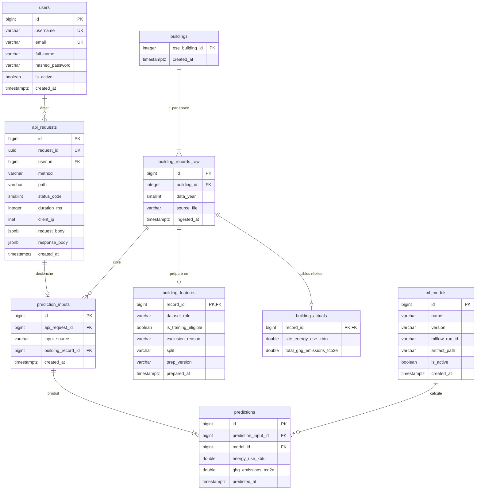

# Design — Intégration PostgreSQL (issue #26)

- **Date** : 2026-10-14
- **Branche** : `26-refactor-mettre-en-place-une-db-le-monitoring-associé`
- **Statut** : validé en brainstorming, en attente de relecture

## 1. Contexte et objectifs

L'issue #26 demande une base PostgreSQL locale qui :

1. contient le dataset complet, structuré ;
2. trace **toutes** les interactions avec le modèle (inputs et outputs dans des tables dédiées) ;
3. offre une traçabilité complète des échanges API ↔ BDD ;
4. est livrée avec un schéma (UML), un script de création et une documentation.

Besoins exprimés en plus de l'issue :

- tracer, **par utilisateur** (`user_id` extrait du JWT), le corps de requête et la réponse de **chaque** appel API ;
- préparer les données en **deux temps** (brut → features) au lieu de le faire à la volée ;
- remplacer l'auth en mémoire (`fake_users_db`) par une table `users` ;
- passer le tracking MLflow (aujourd'hui `sqlite:///mlflow.db`) sur PostgreSQL ;
- tout faire tenir dans un `docker compose` à **deux services** : `api` + `db`.

### Évolution fonctionnelle

- **Entraînement** : dataset Seattle **2016** (actuel).
- **Production** : datasets officiels Seattle **2017, 2018, 2019**, normalisés vers le schéma 2016 par le script d'ingestion, puis préparés de la même façon (sans data leakage, résidentiel exclu).
- `POST /model/predict` reçoit désormais `{"building_id": int, "data_year": int | null}` ; si `data_year` est absent, l'année la plus récente disponible pour ce bâtiment est utilisée.
- La saisie libre actuelle (`EnergyPredictionRequest`) reste disponible sur `POST /model/predict/features` (bâtiments hors base, simulations, tests).
- Les cibles réelles 2017–2019 permettent une **évaluation projetée** du modèle (généralisation temporelle).

## 2. Décisions

| # | Sujet | Décision |
|---|---|---|
| D1 | Granularité des traces | Hybride : `api_requests` (JSONB, tous les appels) + tables typées `prediction_inputs` / `predictions` |
| D2 | Rôle du dataset en base | Source de vérité : `TrainPipeline` lit Postgres, plus le CSV |
| D3 | Format du brut | Colonnes typées miroir du CSV (snake_case), PII conservées |
| D4 | Modes de prédiction | Les deux coexistent : par `building_id` et saisie libre (`manual`) |
| D5 | Périmètre | Résidentiel (`Multifamily*`) stocké en brut, absent des features → 422 à la prédiction |
| D6 | Éligibilité | Les filtres qualité (outliers, conformité, cibles) ne concernent que l'entraînement 2016 |
| D7 | Cibles réelles | Table séparée `building_actuals` ; `building_features` ne contient aucune cible |
| D8 | JWT | `sub = str(user.id)` |
| D9 | Modèles | Table `ml_models` reliée à MLflow par `mlflow_run_id` (sans FK inter-bases) |
| D10 | MLflow | Base `mlflow` séparée dans la même instance ; pas de 3ᵉ conteneur |
| D11 | Stack | SQLAlchemy 2.0 (déclaratif typé) + Alembic ; `sqlmodel` retiré |

## 3. Schéma relationnel

### 3.1 Diagramme



Le diagramme omet les colonnes de données de `building_records_raw`, `building_features` et `prediction_inputs`, détaillées ci-dessous.

### 3.2 Bloc « 17 features » (réutilisé)

Colonnes communes à `building_features` et `prediction_inputs`, dans l'ordre de `FEATURE_COLUMNS` :

| Colonne SQL | Type | Null | Source (`FEATURE_COLUMNS`) |
|---|---|---|---|
| `building_type` | VARCHAR(64) | non | `BuildingType` |
| `primary_property_type` | VARCHAR(64) | non | `PrimaryPropertyType` |
| `neighborhood` | VARCHAR(64) | non | `Neighborhood` |
| `latitude` | DOUBLE PRECISION | non | `Latitude` |
| `longitude` | DOUBLE PRECISION | non | `Longitude` |
| `year_built` | SMALLINT | non | `YearBuilt` |
| `number_of_buildings` | DOUBLE PRECISION | oui | `NumberofBuildings` |
| `number_of_floors` | SMALLINT | non | `NumberofFloors` |
| `property_gfa_parking` | INTEGER | non | `PropertyGFAParking` |
| `property_gfa_buildings` | INTEGER | non | `PropertyGFABuilding(s)` |
| `largest_property_use_type` | VARCHAR(64) | non | `LargestPropertyUseType` |
| `second_largest_property_use_type` | VARCHAR(64) | non | `SecondLargestPropertyUseType` |
| `second_largest_property_use_type_gfa` | DOUBLE PRECISION | oui | `SecondLargestPropertyUseTypeGFA` |
| `third_largest_property_use_type` | VARCHAR(64) | non | `ThirdLargestPropertyUseType` |
| `third_largest_property_use_type_gfa` | DOUBLE PRECISION | oui | `ThirdLargestPropertyUseTypeGFA` |
| `has_natural_gas` | BOOLEAN | non | `Has_NaturalGas` |
| `has_steam` | BOOLEAN | non | `Has_Steam` |

Les catégorielles absentes valent `'UNKNOWN'` (comportement actuel de `prepare_catboost`), d'où le NOT NULL. La correspondance colonnes SQL ↔ `FEATURE_COLUMNS` est définie une seule fois en code (`app/db/mapping.py`) et réutilisée par toutes les lectures/écritures.

### 3.3 Tables

#### `users`

| Colonne | Type | Contraintes |
|---|---|---|
| `id` | BIGINT GENERATED ALWAYS AS IDENTITY | PK — valeur du `sub` JWT |
| `username` | VARCHAR(50) | NOT NULL, UNIQUE |
| `email` | VARCHAR(255) | UNIQUE, nullable |
| `full_name` | VARCHAR(255) | nullable |
| `hashed_password` | VARCHAR(255) | NOT NULL |
| `is_active` | BOOLEAN | NOT NULL, défaut `true` |
| `created_at` | TIMESTAMPTZ | NOT NULL, défaut `now()` |

#### `api_requests`

| Colonne | Type | Contraintes |
|---|---|---|
| `id` | BIGINT IDENTITY | PK |
| `request_id` | UUID | NOT NULL, UNIQUE — renvoyé dans l'en-tête `X-Request-ID` |
| `user_id` | BIGINT | FK `users.id` ON DELETE SET NULL, nullable (appels non authentifiés) |
| `method` | VARCHAR(10) | NOT NULL |
| `path` | VARCHAR(255) | NOT NULL |
| `status_code` | SMALLINT | nullable (NULL tant que la requête est en cours ou si elle a planté avant réponse) |
| `duration_ms` | INTEGER | nullable |
| `client_ip` | INET | nullable |
| `request_body` | JSONB | nullable, **secrets masqués** |
| `response_body` | JSONB | nullable, **secrets masqués** |
| `created_at` | TIMESTAMPTZ | NOT NULL, défaut `now()` |

Index : `(user_id, created_at DESC)`, `(path, created_at DESC)`.

Masquage : les clés `password`, `access_token`, `client_secret` sont remplacées par `"***"` à toute profondeur. Les corps non JSON (formulaire `/token`) sont convertis en dict avant masquage. Les corps non décodables sont stockés sous la forme `{"_raw": "<non-JSON, N octets>"}`.

#### `buildings`

| Colonne | Type | Contraintes |
|---|---|---|
| `ose_building_id` | INTEGER | PK (clé naturelle Seattle) |
| `created_at` | TIMESTAMPTZ | NOT NULL, défaut `now()` |

#### `building_records_raw`

Une ligne CSV normalisée pour une année donnée. Toutes les colonnes source sont conservées, **PII comprises**.

| Colonne | Type | Source CSV 2016 |
|---|---|---|
| `id` | BIGINT IDENTITY, PK | — |
| `building_id` | INTEGER NOT NULL, FK `buildings` | `OSEBuildingID` |
| `data_year` | SMALLINT NOT NULL, CHECK `BETWEEN 2015 AND 2100` | `DataYear` |
| `building_type` | VARCHAR(64) | `BuildingType` |
| `primary_property_type` | VARCHAR(64) | `PrimaryPropertyType` |
| `property_name` | VARCHAR(255) | `PropertyName` (PII) |
| `address` | VARCHAR(255) | `Address` (PII) |
| `city` | VARCHAR(64) | `City` |
| `state` | VARCHAR(8) | `State` |
| `zip_code` | VARCHAR(10) | `ZipCode` (PII) |
| `tax_parcel_identification_number` | VARCHAR(64) | `TaxParcelIdentificationNumber` (PII) |
| `council_district_code` | SMALLINT | `CouncilDistrictCode` |
| `neighborhood` | VARCHAR(64) | `Neighborhood` |
| `latitude` | DOUBLE PRECISION | `Latitude` |
| `longitude` | DOUBLE PRECISION | `Longitude` |
| `year_built` | SMALLINT | `YearBuilt` |
| `number_of_buildings` | DOUBLE PRECISION | `NumberofBuildings` |
| `number_of_floors` | SMALLINT | `NumberofFloors` |
| `property_gfa_total` | INTEGER | `PropertyGFATotal` |
| `property_gfa_parking` | INTEGER | `PropertyGFAParking` |
| `property_gfa_buildings` | INTEGER | `PropertyGFABuilding(s)` |
| `list_of_all_property_use_types` | TEXT | `ListOfAllPropertyUseTypes` |
| `largest_property_use_type` | VARCHAR(64) | `LargestPropertyUseType` |
| `largest_property_use_type_gfa` | DOUBLE PRECISION | `LargestPropertyUseTypeGFA` |
| `second_largest_property_use_type` | VARCHAR(64) | `SecondLargestPropertyUseType` |
| `second_largest_property_use_type_gfa` | DOUBLE PRECISION | `SecondLargestPropertyUseTypeGFA` |
| `third_largest_property_use_type` | VARCHAR(64) | `ThirdLargestPropertyUseType` |
| `third_largest_property_use_type_gfa` | DOUBLE PRECISION | `ThirdLargestPropertyUseTypeGFA` |
| `years_energy_star_certified` | VARCHAR(255) | `YearsENERGYSTARCertified` |
| `energy_star_score` | DOUBLE PRECISION | `ENERGYSTARScore` |
| `site_eui_kbtu_sf` | DOUBLE PRECISION | `SiteEUI(kBtu/sf)` |
| `site_eui_wn_kbtu_sf` | DOUBLE PRECISION | `SiteEUIWN(kBtu/sf)` |
| `source_eui_kbtu_sf` | DOUBLE PRECISION | `SourceEUI(kBtu/sf)` |
| `source_eui_wn_kbtu_sf` | DOUBLE PRECISION | `SourceEUIWN(kBtu/sf)` |
| `site_energy_use_kbtu` | DOUBLE PRECISION | `SiteEnergyUse(kBtu)` |
| `site_energy_use_wn_kbtu` | DOUBLE PRECISION | `SiteEnergyUseWN(kBtu)` |
| `steam_use_kbtu` | DOUBLE PRECISION | `SteamUse(kBtu)` |
| `electricity_kwh` | DOUBLE PRECISION | `Electricity(kWh)` |
| `electricity_kbtu` | DOUBLE PRECISION | `Electricity(kBtu)` |
| `natural_gas_therms` | DOUBLE PRECISION | `NaturalGas(therms)` |
| `natural_gas_kbtu` | DOUBLE PRECISION | `NaturalGas(kBtu)` |
| `default_data` | BOOLEAN | `DefaultData` |
| `comments` | TEXT | `Comments` |
| `compliance_status` | VARCHAR(64) | `ComplianceStatus` |
| `outlier` | VARCHAR(32) | `Outlier` |
| `total_ghg_emissions` | DOUBLE PRECISION | `TotalGHGEmissions` |
| `ghg_emissions_intensity` | DOUBLE PRECISION | `GHGEmissionsIntensity` |
| `source_file` | VARCHAR(255) NOT NULL | nom du fichier ingéré |
| `ingested_at` | TIMESTAMPTZ NOT NULL, défaut `now()` | — |

Hors clés, toutes les colonnes de données sont nullables : le brut reflète la source. Contrainte : `UNIQUE (building_id, data_year)`. Index : `(data_year)`.

Les fichiers 2017–2019 sont ramenés à ces colonnes par une table de correspondance **par année** dans le code d'ingestion (`app/db/ingest.py`) ; une colonne source absente donne NULL, une colonne source inconnue est ignorée et loguée.

#### `building_features`

| Colonne | Type | Contraintes |
|---|---|---|
| `record_id` | BIGINT | PK, FK `building_records_raw.id` ON DELETE CASCADE |
| *bloc 17 features (§3.2)* | | |
| `dataset_role` | VARCHAR(16) | NOT NULL, CHECK `IN ('training','production')` |
| `is_training_eligible` | BOOLEAN | NOT NULL |
| `exclusion_reason` | VARCHAR(32) | nullable, CHECK `IN ('outlier','non_compliant','non_positive_target','missing_target')` |
| `split` | VARCHAR(8) | nullable, CHECK `IN ('train','test')` |
| `prep_version` | VARCHAR(32) | NOT NULL |
| `prepared_at` | TIMESTAMPTZ | NOT NULL, défaut `now()` |

Contraintes croisées (CHECK) :

- `is_training_eligible` ⇒ `dataset_role = 'training'` ;
- `split IS NOT NULL` ⇔ `is_training_eligible` ;
- `exclusion_reason IS NOT NULL` ⇔ (`dataset_role = 'training'` AND NOT `is_training_eligible`).

Index : `(dataset_role, is_training_eligible)`.

Seules les lignes **dans le périmètre** (non résidentielles) sont présentes. Un bâtiment résidentiel existe dans `buildings` / `building_records_raw` mais pas ici.

#### `building_actuals`

| Colonne | Type | Contraintes |
|---|---|---|
| `record_id` | BIGINT | PK, FK `building_records_raw.id` ON DELETE CASCADE |
| `site_energy_use_kbtu` | DOUBLE PRECISION | nullable |
| `total_ghg_emissions_tco2e` | DOUBLE PRECISION | nullable |

Alimentée à l'ingestion à partir des colonnes cibles (`TARGETS`). Lue par l'entraînement (cibles 2016) et par l'évaluation projetée (2017–2019). Jamais lue par l'API.

#### `ml_models`

| Colonne | Type | Contraintes |
|---|---|---|
| `id` | BIGINT IDENTITY | PK |
| `name` | VARCHAR(64) | NOT NULL (`catboost-multitarget`, `kumo-tabular-zero-shot`) |
| `version` | VARCHAR(32) | NOT NULL |
| `mlflow_run_id` | VARCHAR(64) | nullable (Kumo n'est pas entraîné) |
| `artifact_path` | VARCHAR(255) | nullable, relatif au dossier `models/` |
| `is_active` | BOOLEAN | NOT NULL, défaut `false` |
| `created_at` | TIMESTAMPTZ | NOT NULL, défaut `now()` |

Contraintes : `UNIQUE (name, version)` ; index unique partiel `(name) WHERE is_active` (une seule version active par modèle).

#### `prediction_inputs`

| Colonne | Type | Contraintes |
|---|---|---|
| `id` | BIGINT IDENTITY | PK |
| `api_request_id` | BIGINT | FK `api_requests.id` ON DELETE SET NULL, nullable (NULL pour `batch`) |
| `input_source` | VARCHAR(16) | NOT NULL, CHECK `IN ('building_id','manual','batch')` |
| `building_record_id` | BIGINT | FK `building_records_raw.id`, nullable |
| *bloc 17 features (§3.2)* | | snapshot figé de ce qui est envoyé au modèle |
| `created_at` | TIMESTAMPTZ | NOT NULL, défaut `now()` |

Contraintes (CHECK) :

- `input_source IN ('building_id','batch')` ⇒ `building_record_id IS NOT NULL` ;
- `input_source = 'manual'` ⇒ `building_record_id IS NULL` ;
- `input_source = 'batch'` ⇔ `api_request_id IS NULL`.

Index : `(api_request_id)`, `(building_record_id)`.

#### `predictions`

| Colonne | Type | Contraintes |
|---|---|---|
| `id` | BIGINT IDENTITY | PK |
| `prediction_input_id` | BIGINT | NOT NULL, FK `prediction_inputs.id` ON DELETE CASCADE |
| `model_id` | BIGINT | NOT NULL, FK `ml_models.id` |
| `energy_use_kbtu` | DOUBLE PRECISION | NOT NULL |
| `ghg_emissions_tco2e` | DOUBLE PRECISION | NOT NULL |
| `predicted_at` | TIMESTAMPTZ | NOT NULL, défaut `now()` |

Contrainte : `UNIQUE (prediction_input_id, model_id)`. Index : `(model_id, predicted_at)`.

#### Vue `v_projected_evaluation`

Jointure `predictions ⋈ ml_models ⋈ prediction_inputs ⋈ building_records_raw ⋈ building_actuals`, restreinte à `input_source = 'batch'`. Colonnes : `model_name`, `model_version`, `data_year`, `building_id`, valeurs prédites, valeurs réelles, erreurs absolues et relatives. Les agrégats (R², MAE, MedAPE par modèle × version × année) sont calculés par le script `evaluate` à partir de cette vue.

## 4. Flux de données

### 4.1 Ingestion et préparation (CLI, rôle `p5_owner`)

```
python -m app.db.ingest  --year 2016 --csv data/2016_Building_Energy_Benchmarking.csv
python -m app.db.prepare --year 2016
```

**`ingest`** : renomme les colonnes via la correspondance de l'année, puis upsert `buildings`, `building_records_raw` (`ON CONFLICT (building_id, data_year) DO UPDATE`) et `building_actuals`. Idempotent. L'ordre d'insertion respecte l'ordre des lignes du CSV.

**`prepare`** : lit le brut de l'année, puis :

1. `filter_scope` : exclut `BuildingType` commençant par `Multifamily` ;
2. corrections communes à toutes les années (normalisation `Neighborhood`, `NumberofBuildings == 0 → 1`) ;
3. `build_flags` + `prepare_catboost` → bloc des 17 features ;
4. si l'année est l'année d'entraînement (2016, configurable) : `flag_training_eligibility` attribue `is_training_eligible` / `exclusion_reason` selon les règles actuelles de `build_clean` (outliers, `ComplianceStatus != 'Compliant'`, cibles ≤ 0 ou manquantes), puis `split` via `train_test_split(test_size=0.2, random_state=42)` sur les lignes éligibles **triées par `building_records_raw.id`**. Le split reproduit ainsi celui d'aujourd'hui et la baseline reste comparable ;
5. upsert `building_features` avec `prep_version`.

`build_clean` est découpée en `filter_scope`, corrections communes et `flag_training_eligibility`. Les règles ne changent pas. `OSEBuildingID` sort de `PII_COLUMNS` : c'est un identifiant de bâtiment, pas une feature, et il n'est jamais transmis au modèle.

### 4.2 Entraînement (rôle `p5_owner`)

- `TrainPipeline` lit `building_features ⋈ building_actuals WHERE dataset_role = 'training' AND is_training_eligible`. Le découpage vient de la colonne `split`.
- MLflow écrit dans la base `mlflow` (`MLFLOW_TRACKING_URI=postgresql+psycopg://…/mlflow`).
- En fin de run, dans une seule transaction : insertion d'une ligne `ml_models` (`version`, `mlflow_run_id`, `artifact_path`), passage de l'ancienne version active à `is_active = false`, puis de la nouvelle à `true`.
- `models/scores.json` continue d'être écrit : le gate CI #23 n'est pas modifié.

### 4.3 Requête de prédiction (rôle `p5_api`)

1. **Middleware de trace (ASGI pur)** : génère `request_id`, **insère** `api_requests` (`status_code` NULL) et stocke son `id` dans `request.state`. `get_current_user` y place `user_id` ; le middleware le reporte à la sortie.
2. **Résolution** (mode `building_id`) dans `building_features ⋈ building_records_raw` (colonnes `building_id`, `data_year` uniquement) :
   - ID absent de `buildings` → **404** ;
   - ID présent dans `buildings` mais sans features pour aucune année → **422** « hors périmètre du modèle » ;
   - `data_year` fourni mais absent → **404** ;
   - `data_year` absent → année la plus récente.
3. Insertion `prediction_inputs` (snapshot) et **commit**.
4. Prédiction **à partir de la ligne insérée**, pas du payload HTTP.
5. Insertion `predictions` avec le `model_id` de la version active de chaque modèle appelé.
6. La réponse inclut `request_id` et l'`id` de chaque prédiction.
7. **Sortie du middleware** : mise à jour de `api_requests` (`status_code`, `duration_ms`, `user_id`, `response_body` masqué).

Mode `manual` (`/model/predict/features`) : même chemin, sans l'étape 2, avec `input_source = 'manual'`.

`/model/predict/compare` : un `prediction_inputs`, deux `predictions` (CatBoost + Kumo).

`/model/list` lit `ml_models`. `/model/metrics` est inchangé (lit `models/scores.json`).

### 4.4 Évaluation projetée (CLI, rôle `p5_owner`)

```
python -m app.db.evaluate --years 2017 2018 2019
```

Pour chaque ligne `building_features` de production des années demandées : `prediction_inputs` (`batch`) puis `predictions` avec le modèle CatBoost actif, par lots. Le script affiche ensuite les métriques par année (R², MAE, MedAPE) calculées depuis `v_projected_evaluation`. Le script est idempotent par version de modèle : une ligne déjà prédite en `batch` par le `model_id` actif est ignorée. Après un réentraînement, la nouvelle version produit son propre jeu de prédictions et l'historique des versions précédentes est conservé. Les métriques sont toujours calculées pour une version donnée (`model_name`, `model_version`).

### 4.5 Gestion d'erreurs

| Situation | Comportement |
|---|---|
| Échec du modèle | `prediction_inputs` existe sans `predictions` ; 503 enregistré dans `api_requests` |
| BDD indisponible | 503, **aucune prédiction** (pas de prédiction non tracée) |
| Échec de l'écriture finale de `api_requests` | Logué ; la réponse déjà calculée est renvoyée (la ligne existe avec `status_code` NULL) |
| Aucune version active pour un modèle | 503 « aucun modèle actif » |
| Exception non gérée dans un handler | Le middleware enregistre 500 |

## 5. Infrastructure

### 5.1 Docker Compose

```yaml
services:
  db:
    image: postgres:17-alpine
    environment: [POSTGRES_PASSWORD]            # depuis .env
    volumes: [pgdata:/var/lib/postgresql/data]
    ports: ["127.0.0.1:5432:5432"]
    healthcheck: pg_isready
  api:
    build: .
    env_file: .env
    depends_on: { db: { condition: service_healthy } }
    ports: ["8080:8080"]
    volumes: ["./models:/app/models:ro"]
volumes:
  pgdata:
```

Instance unique, deux bases : `p5` et `mlflow`.

### 5.2 Rôles (moindre privilège)

| Rôle | Base | Droits |
|---|---|---|
| `p5_owner` | `p5` | Propriétaire du schéma : migrations, `ingest`, `prepare`, entraînement, `evaluate` |
| `p5_api` | `p5` | `SELECT` : `users`, `buildings`, `building_features`, `ml_models` ; `SELECT (id, building_id, data_year)` sur `building_records_raw` (droit **par colonne**, sans PII) ; `INSERT, UPDATE` : `api_requests` ; `INSERT` : `prediction_inputs`, `predictions` ; `USAGE` sur les séquences d'identité concernées |
| `p5_mlflow` | `mlflow` | Propriétaire de la base `mlflow`, aucun droit sur `p5` |

Le droit par colonne permet à l'API de résoudre `(building_id, data_year) → record_id` sans jamais pouvoir lire une PII. `building_actuals` reste inaccessible à l'API.

### 5.3 `app/db/create_db.py`

Point d'entrée unique et idempotent, lancé explicitement :

```
docker compose run --rm api python -m app.db.create_db
```

Avec `DATABASE_ADMIN_URL`, il :

1. crée les rôles et les bases s'ils n'existent pas (mots de passe lus depuis l'environnement) ;
2. lance `alembic upgrade head` en tant que `p5_owner` ;
3. applique les `GRANT` du §5.2 ;
4. seed les utilisateurs de démo (`johndoe` actif, `alice` inactif), mots de passe hashés à l'exécution.

L'API ne migre pas au démarrage et ne dispose d'aucun identifiant administrateur.

### 5.4 Configuration

`.example.env` est complété avec : `POSTGRES_PASSWORD`, `DATABASE_URL` (rôle `p5_api`), `DATABASE_OWNER_URL`, `DATABASE_ADMIN_URL`, `MLFLOW_TRACKING_URI`, `P5_OWNER_PASSWORD`, `P5_API_PASSWORD`, `P5_MLFLOW_PASSWORD`. Aucune valeur réelle n'est commitée.

### 5.5 Organisation du code

```
app/db/
  __init__.py
  session.py        # engine, SessionDep (remplace core/database_service.py)
  models.py         # tables SQLAlchemy 2.0
  mapping.py        # colonnes SQL <-> FEATURE_COLUMNS / colonnes CSV par année
  redaction.py      # masquage des secrets
  create_db.py
  ingest.py
  prepare.py
  evaluate.py
app/middleware/trace.py
alembic/ + alembic.ini
docs/db/README.md   # diagramme, choix, exemples de requêtes
docs/db/schema.sql  # généré par `alembic upgrade head --sql`
```

Supprimés : `app/core/database_service.py`, `app/schemas/database.py` (`Hero`), `fake_users_db`, dépendance `sqlmodel`. Ajoutés : `sqlalchemy>=2`, `alembic`, `psycopg[binary]`.

## 6. Tests

**Unitaires (sans BDD)** : `filter_scope`, `flag_training_eligibility` (raisons d'exclusion, split identique à l'actuel), correspondance de colonnes par année, masquage (`/token`, imbrication, corps non JSON), JWT `sub = id`.

**Intégration (`@pytest.mark.db`, Postgres réel, rollback par test)** :

- flux §4.3 de bout en bout : une ligne dans chacune de `api_requests`, `prediction_inputs` et `predictions`, avec le bon `user_id` ;
- 404 (ID inconnu, année absente), 422 (résidentiel), 503 (modèle en échec : input sans prédiction) ;
- appel non authentifié tracé avec `user_id` NULL ; mot de passe absent de `api_requests` après `/token` ;
- CHECK : `split` / éligibilité, `input_source` / `building_record_id` ;
- unicité de la version active dans `ml_models` ;
- `p5_api` : `SELECT address FROM building_records_raw` et `SELECT * FROM building_actuals` refusés.

En local : `docker compose up db`. En CI : service `postgres:17` ajouté à `ci-test.yml`. Les tests existants basés sur `fake_users_db` sont adaptés. Le gate `ci-model-performance` est inchangé (il compare des fichiers JSON committés).

## 7. Hors périmètre

- Rétention et partitionnement de `api_requests`.
- Tableau de bord de monitoring (la vue SQL et le script `evaluate` suffisent).
- Rôles applicatifs et scopes OAuth2.
- Déploiement distant (l'issue impose un usage local).
- Acquisition des fichiers 2017–2019 : ils sont fournis manuellement dans `data/`.
