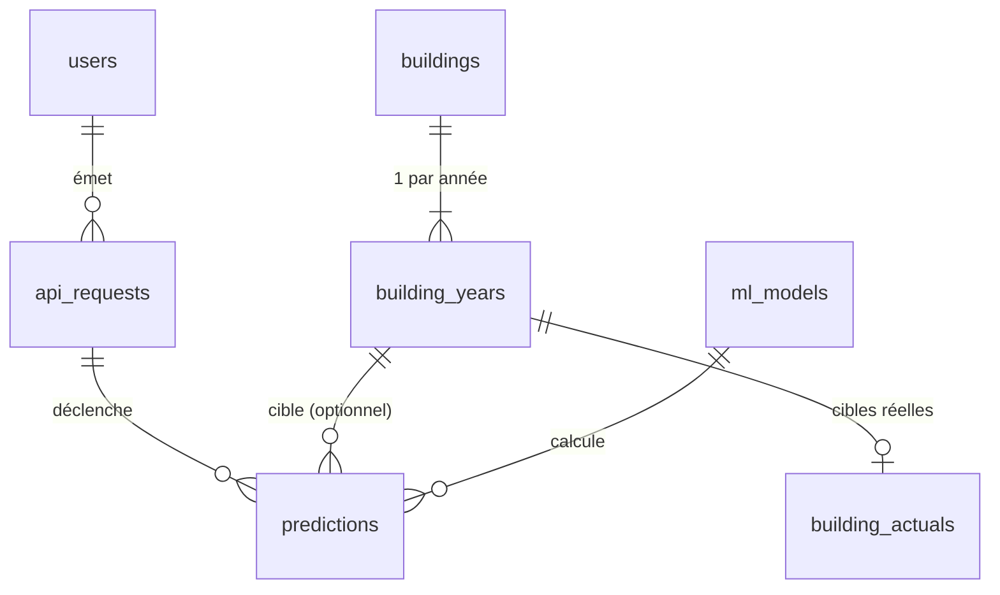

# Schéma simplifié et routes de consultation des bâtiments jamais vus

Issue #45. Deux chantiers livrés dans deux PR distinctes : (1) refonte du schéma, (2) routes de consultation.

## 1. Objectif

Permettre à un utilisateur de retrouver un bâtiment par son nom, son adresse ou son quartier, de récupérer son identifiant, puis de lancer une prédiction sur cet identifiant. **Seuls des bâtiments jamais vus par l'entraînement (train ou test) sont consultables et prédictibles par `building_id`.** La consultation ne renvoie jamais les valeurs réelles (consommation, émissions).

## 2. Audit préalable de l'étanchéité (état actuel)

`python -m app.training` ne lit la base que via `load_training_data`, filtré sur `dataset_role = 'training'` et `is_training_eligible`. Constat en base : 2016 = 1 236 `train` + 310 `test` + 122 exclus ; 2017-2019 = uniquement `production`, sans split. L'étanchéité par ligne est correcte. Limite : 3 195 bâtiments existent en 2016 et dans les années suivantes ; l'exclusion doit donc se faire **par bâtiment**, pas par ligne.

## 3. Périmètre des chantiers

| PR | Contenu | Comportement visible |
|---|---|---|
| 1. Refonte du schéma | Migration, ingestion, entraînement, évaluation, prédiction, droits, tests | Aucun, sauf le split porté par le bâtiment et la disparition de la commande `prepare` |
| 2. Routes de consultation | Router `/buildings`, restriction de `/model/predict` et `/model/predict/compare` | Nouvelles routes, 403 sur un bâtiment vu |

## 4. Schéma cible (7 tables)

- **`buildings`** : `id` (OSEBuildingID, PK), `property_name`, `address`, `zip_code`, `neighborhood`, `building_type`, `primary_property_type`, `split`. `CHECK (split IN ('train', 'test'))` ; `NULL` signifie « jamais vu ». L'identité est la dernière valeur ingérée.
- **`building_years`** : `id` (PK), `building_id` (FK), `data_year`, les 17 features du modèle, `exclusion_reason`, `prep_version`, `prepared_at`. Unicité `(building_id, data_year)`. `CHECK` sur `data_year` et sur les valeurs de `exclusion_reason`. Le split n'y figure plus.
- **`building_actuals`** : `building_year_id` (PK, FK `ON DELETE CASCADE`), `site_energy_use_kbtu`, `total_ghg_emissions_tco2e`. Inaccessible au rôle API.
- **`predictions`** : `id`, `api_request_id` (nullable), `building_year_id` (nullable), `model_id`, `input_features` (JSONB, non nul), `energy_use_kbtu`, `ghg_emissions_tco2e`, `predicted_at`. `CHECK (api_request_id IS NOT NULL OR building_year_id IS NOT NULL)`.
- **Inchangées** : `users`, `api_requests`, `ml_models`.
- **Vue `v_projected_evaluation`** : réécrite sur `predictions ⨝ building_years ⨝ building_actuals` pour les lignes sans `api_request_id`.
- **Supprimées** : `building_records_raw`, `building_features`, `prediction_inputs`.

Source d'une prédiction, déduite des colonnes : `api_request_id` et `building_year_id` renseignés = appel API par bâtiment ; `api_request_id` seul = saisie libre ; `building_year_id` seul = évaluation par lot. `/model/predict/compare` crée deux lignes avec le même `api_request_id`.

Éligibilité à l'entraînement : `buildings.split IS NOT NULL` **et** `building_years.exclusion_reason IS NULL` **et** année d'entraînement (`TRAINING_YEAR`).

### Droits du rôle `p5_api`

`SELECT` sur `users`, `buildings`, `building_years`, `ml_models` ; `SELECT, INSERT, UPDATE` sur `api_requests` ; `SELECT, INSERT` sur `predictions` ; `USAGE` sur les séquences concernées. Plus de droit par colonne ; aucun accès à `building_actuals`.

## 5. Pipeline de données

`ingest --year Y --csv …` exécute en une passe : harmonisation, nettoyage, upsert de `buildings`, upsert de `building_years` (features + `exclusion_reason`), upsert de `building_actuals`.

- Pour `Y == TRAINING_YEAR` : attribution du split (`assign_split`, seed 42, 20 % de test) aux bâtiments éligibles, écrite dans `buildings.split` ; les autres bâtiments gardent `NULL`.
- `exclusion_reason` est renseignée pour toutes les années : règles actuelles de `prepare.py` pour l'année d'entraînement, règles actuelles d'`evaluate.py` (conformité, plages d'intensité, cible non positive) pour les autres. L'évaluation projetée et la consultation s'appuient sur cette colonne ; la prédiction par `building_id` ne l'utilise pas.
- La commande `prepare` est supprimée ; `prepare.py` ne garde que des fonctions pures.
- Les bâtiments hors périmètre (résidentiel, features obligatoires manquantes) n'ont aucune ligne `building_years` et n'apparaissent donc jamais en consultation.
- `harmonize` lit le type de bâtiment de référence dans `buildings.building_type` (plus de requête sur le brut). Les CSV de `data/` restent la source rejouable.

## 6. Routes de consultation (PR 2)

Toutes protégées par Bearer. Condition de consultation, définie une seule fois dans une fonction partagée : `buildings.split IS NULL` et au moins une ligne `building_years`. Les lignes 2016 exclues de l'entraînement sont donc consultables (le modèle ne les a jamais vues).

- **`GET /buildings`** : paramètres `q` (nom ou adresse, `ILIKE`, `%` et `_` échappés), `year`, `neighborhood`, `building_type`, `limit`, `offset`. Réponse paginée `{items, total, limit, offset}` ; chaque item porte l'identité et la liste des années disponibles. Pas d'index trigramme (environ 3 200 bâtiments).
- **`GET /buildings/{building_id}`** : identité et features par année, sans valeurs réelles. Un bâtiment vu renvoie 404 (son existence n'est pas révélée).
- **`POST /model/predict` et `/model/predict/compare` par `building_id`** : un bâtiment dont `split` n'est pas `NULL` renvoie 403 avec un message explicite. La saisie libre (`/model/predict/features`) est inchangée.

## 7. Migration

Migration Alembic destructive : suppression de `building_records_raw`, `building_features` et `prediction_inputs`, recréation des nouvelles tables et de la vue, mise à jour des `GRANT` dans `create_db`. `users`, `api_requests` et `ml_models` sont conservées. L'historique de `predictions` est perdu (traces de développement). Reconstruction des données : `create_db`, puis un `ingest` par année. `docs/db/README.md` et `docs/db/schema.sql` sont mis à jour dans la PR 1.

## 8. Tests

- Adaptés : `synth.py`, `test_db_models`, `test_db_schema`, `test_db_ingest` (absorbe `test_db_prepare`), `test_db_evaluate`, `test_db_training`, `test_predict_api`, `test_api_role_e2e`.
- Isolation (PR 1) : `load_training_data` ne renvoie que des bâtiments `split IS NOT NULL` de l'année d'entraînement, sans `exclusion_reason`.
- Isolation (PR 2) : la consultation ne renvoie jamais un bâtiment vu, quels que soient `q`, `year` ou `offset` ; `GET /buildings/{id}` d'un bâtiment vu répond 404 ; la prédiction par `building_id` d'un bâtiment `train` ou `test` répond 403.
- Nouveau : `test_buildings_api.py`.
