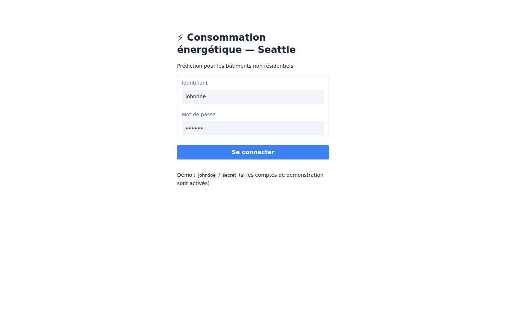
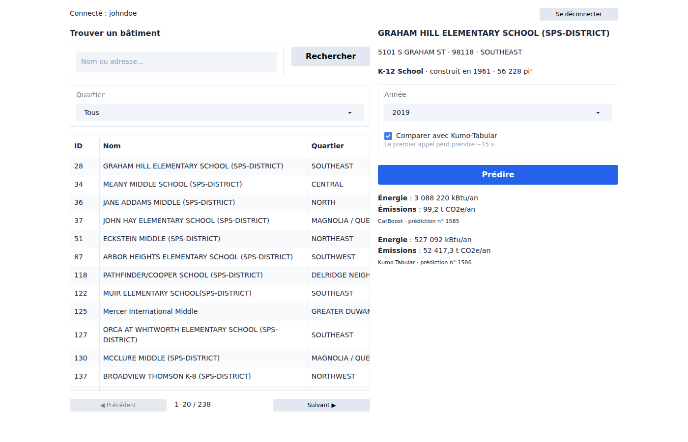

# 🖥️ Interface de démonstration (Gradio)

Une interface web claire et épurée pour le parcours de démonstration : se connecter, trouver un bâtiment jamais vu par l'entraînement, voir sa fiche et obtenir sa prédiction, avec en option la comparaison avec Kumo-Tabular. Elle est démarrée et vérifiée par le Quickstart. Conception : [`docs/superpowers/specs/2026-10-18-interface-gradio-design.md`](../superpowers/specs/2026-10-18-interface-gradio-design.md).

## Accès

| | |
|---|---|
| URL | http://localhost:7860 (`UI_PORT` pour changer de port ; publié sur `127.0.0.1` uniquement, et hors Docker `GRADIO_SERVER_NAME` vaut `127.0.0.1` par défaut) |
| Compte | un utilisateur de l'API ; en démonstration `johndoe` / `secret` (comptes créés si `P5_SEED_DEMO_USERS=1`) |
| Thème | clair, même si le navigateur est en mode sombre |

## Parcours



1. **Connexion** avec les identifiants de l'API. Le jeton est conservé en mémoire **côté serveur**, par onglet (`gr.State`) : il n'est ni envoyé au navigateur, ni écrit, ni journalisé. L'historique des exécutions de Gradio, qui enregistrerait les saisies (dont le mot de passe) dans le navigateur, est désactivé. La déconnexion oublie le jeton, efface le mot de passe et la fiche affichée.
2. **Trouver un bâtiment** : recherche par nom ou adresse (2 caractères minimum), filtre par quartier, pages de 20. Seuls les bâtiments jamais vus par l'entraînement sont listés : ce sont les seuls prédictibles par identifiant.
3. **Fiche** : un clic sur une ligne affiche l'identité, l'usage principal, l'année de construction et la surface ; la dernière année disponible est présélectionnée.
4. **Prédire** : consommation (kBtu/an) et émissions (t CO2e/an) CatBoost, avec le numéro de la prédiction tracée en base. Avec « Comparer avec Kumo-Tabular », la prédiction zero-shot s'affiche en dessous ; le premier appel après un démarrage télécharge les poids de Kumo (~15 s).



Les erreurs de l'API s'affichent telles quelles dans un bandeau (bâtiment inconnu, modèle indisponible…). Une session expirée (jeton de 30 min) ramène à l'écran de connexion avec « Session expirée, reconnectez-vous ».

## Architecture

```
navigateur ──► ui (Gradio, :7860) ──HTTP + JWT──► api (:8080) ──► PostgreSQL
                                                   │ middleware de traçabilité
                                                   ▼
                                      api_requests (user_id) ──► Grafana
```

L'interface est un **client HTTP de l'API** : elle ne lit ni la base ni le modèle et ne reçoit ni `SECRET_KEY` ni `DATABASE_*`, seulement `P5_API_URL`. Chaque action passe donc par l'authentification JWT et le middleware de traçabilité : elle apparaît dans le [monitoring](../monitoring/README.md) au nom de l'utilisateur connecté.

| Fichier | Rôle |
|---|---|
| [`app/ui/client.py`](../../app/ui/client.py) | `ApiClient` : seul point de contact avec l'API ; erreurs converties en messages français, 401 → `SessionExpired` |
| [`app/ui/format.py`](../../app/ui/format.py) | Nombres au format français (`3 088 220`, `99,2`), fiche et résultat en Markdown |
| [`app/ui/app.py`](../../app/ui/app.py) | Écrans, thème et gestionnaires d'événements (fonctions testées sans réseau) |
| [`app/ui/__main__.py`](../../app/ui/__main__.py) | `python -m app.ui` |

Le service `ui` utilise la **même image** que l'API (commande `python -m app.ui`) : il est construit, scanné et publié avec elle. Gradio n'envoie ni statistiques ni vérification de version (`GRADIO_ANALYTICS_ENABLED=False`), n'expose pas ses événements en API publique (`api_visibility="private"`) et ne garde aucun historique des exécutions dans le navigateur (`run_history=False`).

## Lancer hors Docker

Avec une API lancée par ailleurs (par exemple `uv run fastapi dev app/main.py`, port 8000) :

```bash
P5_API_URL=http://localhost:8000 uv run python -m app.ui   # http://localhost:7860
```

## Tests

```bash
uv run pytest tests/test_ui_client.py tests/test_ui_app.py tests/test_ui_format.py
```

- `test_ui_client.py` : le client à travers la **vraie API** (base de test), y compris la traçabilité au nom de l'utilisateur ;
- `test_ui_app.py` : chaque gestionnaire (connexion, recherche, pagination, sélection, prédiction, session expirée, déconnexion) et le câblage Gradio (aucun avertissement de signature) ;
- `test_ui_format.py` : format français et valeurs manquantes (« — »).
